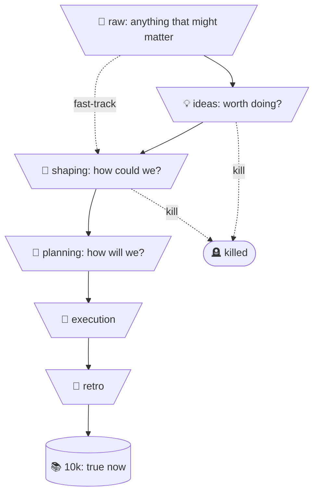
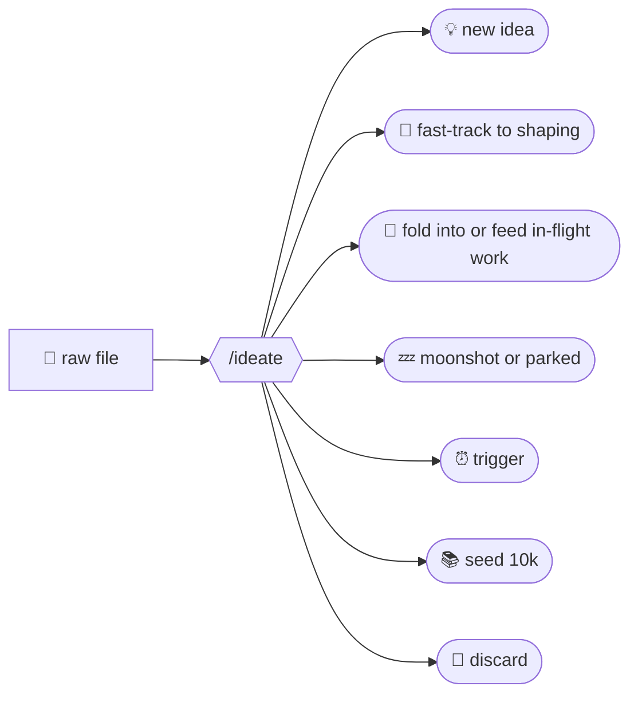

[Your first loop](../../start-here/first-loop/) walked you down the funnel's main road, one command at a time. This page covers the rules of that road and generally how Ang manages the messy realities every software development endeavour encounters. It covers things like: what belongs in `raw/`, what has to be true before your work moves on, and all the alternate paths you might have to take when work items need to merge together, get killed, or wait their turn. The first loop showed you the route. This page is about how to drive it and the best ways to weave through traffic.

Haven't done your first loop yet? Here's the funnel in a nutshell:

> Lots of thoughts go in the top, and by the time something reaches execution it has earned its spot, so you're never spending an afternoon on architecture for an idea that wasn't worth doing in the first place.

## 🎯 One question per stage

Everything Ang does in the funnel hangs off one idea: each stage answers exactly one question, and each command works on exactly that question. That keeps every session focused, because the agent only has to hold what *this* question needs, not the whole history of your project. A lot of frameworks feed every agent everything the project has ever collected. Ang prefers to curate its context, so each agent gets only what its question needs, and that's what keeps Ang's agents so sharp. There's more on how this happens in the page on [The context library](../context-library/).

| Stage     | The question you're asking                                                                                                                        | What you run                                                                              |
| --------- | ------------------------------------------------------------------------------------------------------------------------------------------------- | ----------------------------------------------------------------------------------------- |
| raw       | "I've had a thought, something's happened, or I've learned something new. Does it matter to the project?"                                         | `/ideate`                                                                                 |
| ideas     | "Is this worth pursuing? What's already out there, what are my options, and what are other people in my situation doing?"                         | `/refine-ideas`, `/kill`                                                                  |
| shaping   | "OK, this seems worth doing. How *could* we do it, and is there a way that's viable for us?"                                                      | `/shape-ideas`, `/kill`                                                                   |
| planning  | "We know what we want and that it's the right call. How are we *actually* going to do it?"                                                        | `/plan-epic`                                                                              |
| execution | "Awesome! Let's build it, one story at a time."                                                                                                   | `/break-down-epic`, then per story `/write-story`, `/implement-story` and `/review-story` |
| retro     | "The software's better and our users are going to be stoked, but a lot has changed. What's true now, and what did we learn that's worth keeping?" | `/retro`                                                                                  |

The order work items move through this funnel matters. Ideas asks *whether*, shaping asks *how could we*, and planning asks *how will we*. Answering them out of order is how you end up with a beautifully planned feature nobody wanted. If you want more detail on the commands themselves and how they work, each command gets its own entry in [Commands: the funnel](../../commands/funnel/).

Here's the funnel from top to bottom. The solid line is the main road, and the dotted lines are the side doors out of it. `raw/` has a few more doors of its own, which get their own picture [below](#-raw-a-place-to-pour-the-mess).

## 📝 Raw: a place to pour the mess

`raw/` exists because of a problem I had. I had a huge mess of thoughts about a new product: some about architecture, some about marketing, some I'd firmly decided, and some where I didn't know the first thing to look into. With so many places I could start, I couldn't tell which one actually mattered most. The usual advice is "don't worry, just start on *anything*". But I knew that if I couldn't apply some structure to the chaos in my head, then where I started would come down to a roll of the dice. Any old thing wasn't what I wanted to be working on. I wanted to be working on the **most** important thing I could be doing *right now*. Doing that would make my work go a lot further. What I wanted was to pour the whole lot onto a page and have someone/something sort it logically into things I could start work on. So that's what `raw/` is.

Giant brain dumps are only one use for it, though. Whether we like it or not, software development keeps a thread running in the back of our brains. It quietly rolls problems around, and it's always on the lookout for the next input that might crack a problem we're stuck on wide open. Everyday work throws those inputs up all the time: a surprise ticket, a shower thought, a news article that shifts the landscape your product lives in, a chat with another developer. Ang is built to expect that steady stream of new and possibly game-changing information, and `raw/` is where it lands. Whenever something comes along that you think might matter to the project, drop it in. Anything your agent's harness can read is fair game: notes, tickets, articles, chat logs, pasted docs. It doesn't need to be tidy. It just needs to exist where Ang can get at it and start helping you make sense of it.

There are a few habits worth getting into with `raw/`:

- **Commit it first.** `/ideate` deletes the raw files it consumes once it's done with them, trusting git to keep the originals. That only works if the file is committed, so if it isn't, `/ideate` stops and asks you to commit it before it reads a word. (`/bootstrap-repo` reads `raw/` the same way.)
- **Sensitive files can skip the commit.** Sometimes you want Ang to know about something you'd rather not show anyone who can run `git log`! That's fine. Put it in `raw/` but don't commit it, and when Ang flags that it isn't committed, tell it the file is sensitive. Ang reads it and uses it like any other input, but it won't commit it and won't delete it. Once you've got what you need out of `/ideate`, delete the file yourself and you're good to go.
- **You don't have to explain every file.** Ang fills in the blanks where it can, and asks you where it can't.

When you run `/ideate`, Ang splits each raw file into its separate threads and proposes one action per thread, five at a time, for you to agree or change. A thread can become:

- **a new idea**, the default, when there are real questions about *whether* or *what*
- **a fold-in** to an item that's already in flight, when it overlaps
- **a fast-track to shaping**, when you've clearly already decided to do it and only the *how* is open
- **input for in-flight work**, when it's a fact that something being shaped, planned or built needs to know
- **a moonshot**, a long-range vision to keep in mind rather than work on
- **a parked entry**, doable but worth nothing until a named wake condition comes true
- **a trigger**, when you already know what to do and how, but it's stuck behind something else that has to happen first
- **a seed for `10k/`**, when it's already true and `10k/` is still empty, in which case Ang points you at `/bootstrap-repo`
- **a discard**. Ang is sure you have lots of very good ideas, but this one just isn't one of them. It tells you why. If you think it's being unfair, talk it through and tell it what it's missing. If you agree it's maybe not relevant, no more time need be wasted, we drop it, and we all move on.

Or, if you're more of a picture person:

So the payoff of running `/ideate` over your raw files is this: the moment something lands in `raw/`, it either finds its place in the funnel or gets a deliberate decision about why not. Your ideas are captured while they're fresh, and nothing gets lost in a backlog left to rot.

## 🚦 When does my item move on?

At the end of a `/refine-ideas` or `/shape-ideas` session, and once a `/plan-epic` session reckons the plan is complete, Ang hands your item to `stage-gate`. It's an agent whose whole job is to be the skeptic in the room. It reads what the item has learned so far and judges one thing: is it ready for the next stage?

Its default answer is "not yet", but it isn't a perfectionist. Call it a realist. The best results live somewhere between "fail to plan, plan to fail" and "no plan survives contact with the build", and `stage-gate`'s job is to draw that line, so that you get speed without giving up quality. Once the next stage can start working in a sensible direction, the item moves on. Carrying open questions forward is fine, as long as they're the kind of question the next stage is built to answer. What isn't fine is carrying a question this stage could still answer, because this stage is the one built for it.

Here's what each exit asks for, in plain terms:

- **Ideas moves to shaping when** there's evidence the problem is real and worth solving, you know what solutions are already out there, and what's left are "how could we" questions that need a spike, a prototype or an experiment rather than more reading.
- **Shaping moves to planning when** the approach you've picked is backed by evidence. Tech choices have been spiked or tested head to head, unless you've already made the call yourself, and the approach is viable for you, in cost and in how it fits what you've already built. Anything still open is planning detail, or something the real world won't let you know yet (or ever, for any reasonable effort). Questions like that go forward with a best guess written down.
- **Planning moves to execution when** the plan spells out scope, what's out of scope, the approach and how you'll know it worked, and nothing left open would stall writing the stories. Technical work also needs its C4 (a standard set of four architecture diagrams) and a test strategy. Business work needs its deliverables, tools and success measures.
- **Execution moves to retro when** every story is done. `/retro` checks that before it starts.

You get `stage-gate`'s verdict, the reasoning behind it, and if it's "not yet", the specific gap to close next. So if an item isn't moving as fast as you expected, you're never left guessing why. And you won't navel-gaze forever in one stage either, because the gate keeps asking whether it's time to move on.

When the answer is yes, the move happens in that session, and the agent tells you which command to run next in a fresh one. Like everything else, the move lands as unstaged changes, so the final call is still (say it with me) **yours**. If you'd rather give it another round first, ask the agent to undo the move, commit the session's progress, and run the stage's command again in a fresh session.

The same goes the other way. Sometimes the right play is to bite off more than you can chew and then chew like hell, and Ang knows it. If `stage-gate` says "not yet" but you're confident moving on is the right call, or you've simply got no choice but to carry on over shaky ground, tell the agent and it'll move the item anyway. Ang isn't your dad or your boss. It wants the best for you, but it's not here to tell you what to do. It's here to help you work within the realities you're battling against, long enough to find a way to push through to success.

## 🔀 One item, all the way down

An item is a folder, and the whole folder moves when the item does, so everything it's learned travels with it. Shaping never has to go hunting for what ideas found out, and so on all the way down the funnel.

Sometimes two things start out separately in the funnel and turn out further down to overlap heavily, or to be the same thing outright. When that happens, Ang merges them. A merge always leaves **one** item, not two sharing a folder. Now that one new item carries everything both of the earlier ones learned along the way.

You'll see this when `/ideate` folds a thread into something in flight, or when `stage-gate` finishes a `/refine-ideas` session and finds a matching item already in shaping. The clearest example is `/plan-epic`, where merging is a step in its own right. It groups shaped items that are ready and work towards closely related outcomes into one epic. In doing so it tucks each item's findings under the epic's `origins/` folder.

Merging earns its keep early in the funnel, while items are still taking shape and you're still finding out what they mean for the project. What you discover along the way often means finishing one item delivers you a result on another one effectively for free, and spotting those wins as you go is a big part of what makes the funnel worth the trip.

But planning is the last stage where merges happen. Once you're in execution, you're building, and the epic is the epic. You've put a lot of time into understanding the problem and agreeing how to solve it, and changing direction now only takes a match to all of that. You can still steer agents mid-build to cover the gaps in the plan that real-world delivery always turns up and planning could never have seen coming. But if merging carried on into execution, Ang would become an accomplice to the high crime of feature creep, and that ain't what Ang is about!

## 🪦 Killing an idea

Sometimes the answer to "is this worth doing?" is no, and that's a great outcome. You've just saved yourself the build.

Killing works on ideas and shaping items. When Ang proposes something be killed, it gives its reasons, and nothing happens unless you agree. If you decide that killing the item is the best way to go, Ang records the reason in the item, you commit that, and Ang deletes the folder in a commit of its own, with a message like `kill: dark-mode — the loud three were the only ones asking`. Git is the archive. If you ever change your mind, the item is sitting in the log waiting to be revived. There's more on the kill command itself in [Commands: library upkeep](../../commands/library-upkeep/).

Why only ideas and shaping? Because that's where most of the funnel's trimming happens. By the time an item reaches planning or execution, you've already put a lot into making sure your idea is reasonable, possible and valuable, so killing it there should, hopefully, be **extremely** rare.

Real life does happen, though, and sometimes you'll find yourself here. But if your idea has reached planning before you decide to kill it, there are just too many ways you might want to go for one set of rules to cover. Do we bin the lot and pretend it never happened? Is there anything to salvage in what you learned, or what you built? It would be impossible to guess, so when you find yourself in these situations, here's what you do: open a fresh session and work out a plan with the agent. With Ang installed, every new session is an Ang agent. It knows the framework, so it can walk you through your options and help you recover from whatever stopped you in your tracks.

## 💤 Moonshots and parked work

Not every thread earns its place as an item, but some are too good to throw away. Those land in two lists in `ideas/`.

`moonshots.md` holds long-range visions that you'll never work on directly. These are the ideas that could send shock waves through your industry, but if you told anyone you were aiming for them, they'd ask if you were doing OK. Building them head-on doesn't make sense. Still, any day now, the thing you're working on might leave a cheap opening that brings you a step closer, and on that day you'll be glad you wrote your idea down. Each entry says what the vision is, why it matters, and what a cheap opening might look like. Ang can propose a moonshot, but you confirm every one, because some hard things are ideas you want tackled now, others are for another day, and others maybe don't exist in the market because they just aren't good ideas!

**`parked.md`** holds doable work that's worth nothing *yet*. Parked ideas are the yin to moonshots' yang. A moonshot's value is obvious. What we're waiting on is a *how*. A parked idea is a slam dunk to build. What we don't have yet is a *why*. Maybe it might be worth something, but you want to see what the next few epics do to the landscape first. Or maybe it would solve a problem you've never actually seen happen. You can't put your finger on why, but you're sure it would be useful...maybe. You could spend time building it to grab at that purely hypothetical value, or you could do the smart thing and park it until the evidence turns up that it's worth doing in the first place. Each entry names the wake condition that would make it worth doing, plus where the idea originally came from.

You never have to go through these lists yourself, so they don't add to your to-do pile. But unlike most backlogs, these lists aren't where good ideas go to be forgotten. `/refine-ideas` and `/retro` mention any parked entry whose wake condition looks to have come true. `/shape-ideas` keeps an eye out for any cheap openings that the things it's working on might leave for you to reach out and grab a moonshot. The agent won't change gears and immediately start building towards it, but it will let you know that your chance is there waiting to be taken.

When an entry's time comes, whether a parked idea's wake condition has come true or a moonshot has suddenly become possible, now is your time to act! Cut the entry out of its list, paste it into a new file in `raw/`, and run it back through `/ideate`.

There's one more way that a work item might need to wait outside of moonshots and parked work which Ang can help you manage. Moonshots are waiting on a how and parked work is waiting on a why. But sometimes you know what to do, how to do it and why it matters, and the only problem is that the answer to the question of *when* is: "not yet". Perhaps it's "once story 4 is done", or "after the 1st of March". What you've got in that situation might feel like parked work, but it isn't. It's a [trigger](../../concepts/triggers/).

## 💼 Not just for code

Ang isn't only for writing code. It's built to support the whole job of building and selling software products, so the same funnel runs business work too: "who's our target audience?", "what should we charge?", "launch the mailing list". The stages, the questions and the evidence bar Ang uses are all the same, and business and technical items can shape each other as they go. Only a few things look a bit different when you point Ang at business problems:

- In shaping, spikes become **experiments**: a landing page, a survey, a price test, some outreach. Ang drafts the materials, and when a human needs to do something, it guides you through the steps.
- Epics get a type, `technical`, `business` or `mixed`, and business epics skip the C4 diagrams.
- Some stories are **yours** instead of an agent's. Signing up for a service, making a call, making a decision: Ang preps everything it can, walks you through it, and records how it went.

Everything ends up in the same place: what delivery proved lands in `10k/` at retro. Which brings us neatly to where all of this lives. Next up: [The context library](../context-library/).