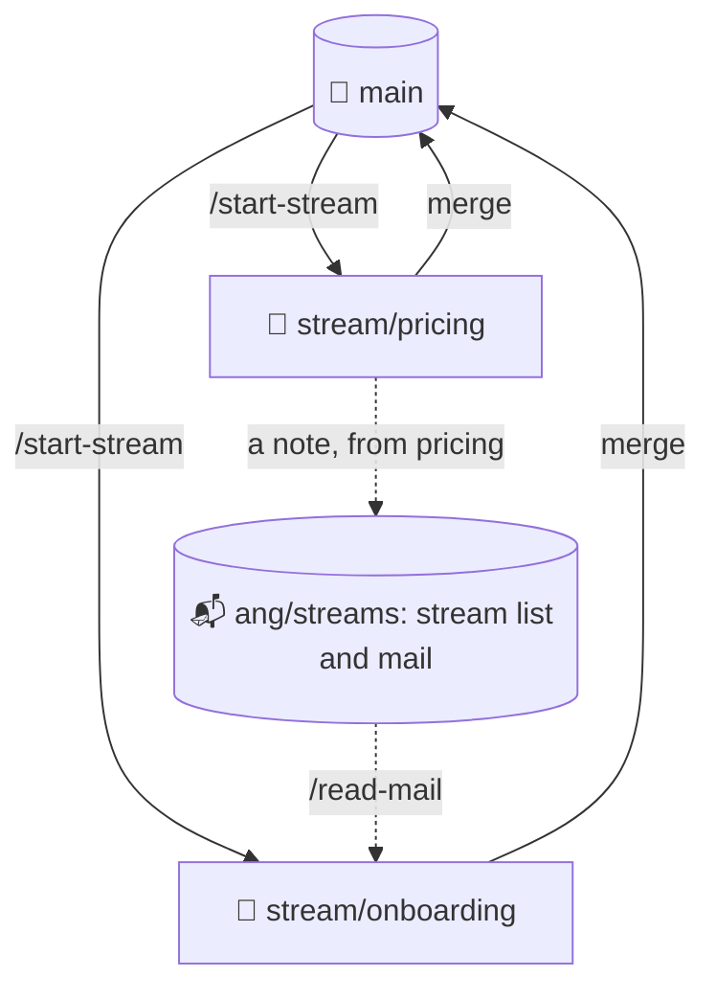

One agent at a time is a fine way to work, right up until the agent is an hour into a long build and you're sitting there watching it. Streams let you put that time to use. While one agent builds, another can be shaping the next idea, and you can be reviewing a third one's finished story. It's a bit like cooking with every burner on the stove going: each pot looks after itself, and your job is knowing which one's about to boil over.

Streams are optional and off by default. If you're ready to take your Ang usage to the next level, they might be just what you're looking for. But if one thing at a time suits you, you can skip this page entirely and lose nothing.

## 🌊 What a stream is

A stream is a corner of your repo you cordon off to work on something independently: **one branch in one worktree**. (A worktree is git's way of having several branches checked out at once, each in its own folder.) What you do in a stream is up to you. Work an item through just one stage, take one idea all the way from `raw/` to retro, or simply use it to raise workflow improvements. Ang runs exactly as it usually does inside each one, with the same commands, the same library and the same rules.

To turn streams on, set `streams` to `true` in your repo's `ang.json` (more on that in [Config](../../reference/config/)). That's all the setup there is: from your next session on main, you're ready to go. When you first set Ang up, `/bootstrap-repo` asks whether you want to use streams and writes that setting for you. It'll suggest leaving them off, because for most people that's the right choice, but if you said yes, you're already set to rock and roll.

Streams unlock ways of working that only really make sense now that agents can build software alongside you. But as the old saying goes, just because you have a hammer doesn't make every problem a nail. Unless you've got work with several threads that can move forward independently, or tasks that would tie up a single agent for long stretches, you might not see the **real** benefits streams provide. That's fine, and there's value in keeping your workflow as simple as it can be, while still providing what you need from it.

That said, if you think streams could improve your time with Ang, let's take a look at how to use them.

## 🚀 Starting and ending a stream

You start a stream from a session on main:

```text title="Start a stream"
/start-stream <slug> "<focus>"
```

The slug is a short kebab-case name that you choose, and the focus is one line saying what the stream is for. So something like:

```text
/start-stream pricing "Working out what we charge, from research through to the pricing page"
```

Run that, and Ang cuts a `stream/pricing` branch from main and creates a worktree for it next to your main checkout. It copies across any gitignored files your repo lists in `.worktreeinclude` (like a `.env.local`), so the stream's worktree starts with the same settings as your main checkout, and it registers the stream on the branch that holds Ang's stream records, so your other streams can see it. Now you're ready to open a new agent session in the new worktree and get going.

The focus line is worth a moment's thought. As I'm sure you've gathered by now, a lot of Ang's power comes from its agents grabbing only the context they need for the task you gave them. Turning on streams naturally puts a lot more context within their reach. The focus line is what agents in your other streams read to decide whether this stream might know something they need, so it's how they keep their context windows lean even with all that extra material to sift through or avoid. A focus like "pricing stuff" helps nobody, while one like the example above tells them exactly when it's worth a look. If you leave the focus out, Ang suggests one. It's that important.

When a stream's work is done and it has been merged to main, you can end it from a session on main, so Ang can tidy up the artefacts that the stream has left behind:

```text title="End a stream"
/end-stream pricing
```

Ang first checks the branch really is merged. If it isn't, it stops and shows you what would be lost, and only carries on if you explicitly tell it you're abandoning the stream. Then it walks you through any mail still waiting for that stream, since nobody will ever read it once the stream's gone. It deregisters the stream and offers to remove its worktree and branch, doing each only on your yes.

Mail?! Sorry, I've got ahead of myself there, but stay with me. For now, just know that streams can collaborate by sending each other mail (it's all very cute), and I'll explain how it works [further down](#-mail-and-why-you-mostly-wont-get-any).

## 🌳 Where Ang keeps track of streams

The list of streams and the mail between them live on a branch called `ang/streams`. You don't need to create it: your first `/start-stream` does that when it registers your first stream. It shares no history with main, no worktree ever checks it out, and Ang reads and writes to it through git with precise commands, so it never interferes with your working files or any of your other branches.

You've seen that when you work with Ang, it leaves its changes unstaged for you to review, and only makes the odd deletion commit itself when you `/kill` an idea or finish a `/retro`. `ang/streams` is the other exception. Ang always wants to leave you in control, but it also doesn't want to burden you with the bookkeeping it does in the background to make streams work. So `ang/streams` is Ang's own little playground, and Ang commits to it for you without bothering you with the details of a branch that, for all intents and purposes, you don't really care about.

Rest assured, even with streams turned on, Ang sticks to the rules for everything else, and your work still lands unstaged, just as you've come to expect. Even on `ang/streams`, Ang only ever writes after you've said yes to something: a stream you started or ended, or a note you approved. Each write is also pushed to `origin` if you have one, so your streams survive a fresh clone, or the unfortunate event of you dropping your laptop in a puddle while running for a bus.

But why make a branch in your project's repo? Well, for streams to work, the stream list and mailbox have to be one shared thing every worktree can see. I could have put them in `project-context/`, but then every worktree would have its own copy, drifting apart with every edit. I could've put them inside `.git/`, but then they'd never get pushed to the remote. If you lost your local files, at best you'd have to recreate the stream list from scratch, and at worst you'd lose important notes your streams had sent each other. On a branch, they're shared by every worktree on your machine, travel with the repo, and are kept safe in the same remote as the rest of your work, which is exactly what's needed.

Here's the whole picture, with two streams on the go:



## 📬 Mail, and why you mostly won't get any

Streams let you work on several things in your project at once. Or, if you're using Ang in a team, they let different people work on different things. Either way, each stream moves forward on its own, but the work in one stream will often affect the work in another. What you don't want is agents carrying on with their heads down, walking unaware towards the nightmare scenario where two streams have been happily building the same software as if it existed in two completely different realities, neither giving a thought to the changes the other is making. So when the work in one stream is likely to change how, why or when another stream does its work, Ang can send that stream a note, letting its agents know how things have shifted and what that might mean for them.

Before you picture an inbox filling up with agents bragging to each other about all the great work they're doing: **no mail is the normal outcome**. Agents know that mailing another stream is an option, not an obligation, and that they should only pass notes that actually matter.

So Ang agents have been told that when it comes to sending notes, being prudent is a virtue. Here's why it's built that way. A note doesn't have to be dealt with the first time Ang tells you about it, because you might have more important things to do in that moment. But until it's dealt with, every session in the receiving stream sees that it has mail, and pays for it in tokens. So a note that doesn't matter costs far more than a note that never got sent, because when you spend an agent's context window, you're spending its ability to remain effective.

A missed note isn't the end of the world, because there are other safety nets:

- **Another chance to send it.** Several workflow commands give a stream the chance to suggest a note, so if one session misses something, a later one may well catch it.
- **The receiving stream can look for itself.** Every stream's branch can be read from every other worktree if they think they need to. So when an agent in the receiving stream gets to the part of its work that overlaps with another stream, it can go and look at what that stream is doing without the need for mail from that stream at all (more on that [below](#-how-one-stream-knows-what-another-is-doing)).

All this is to say, the mail system isn't a perfect, deterministic way to stop streams drifting out of line, but it gives Ang's agents plenty of chances to catch drift that might hurt your ability to deliver your software. Can it avoid all misalignment all the time? No. But let's face it, we've all had times working in software teams where you only found out at the very end of a long sprint that the square peg your colleague has been working on doesn't quite fit the round hole you'd made for it (thanks, Derick!!). Ang does its best to avoid these problems, but it doesn't claim to always be better at it than you were at managing the same problem. It kind of... is what it is 🤷

### 📤 Sending a note

The suggestion to send a note can only happen at a mail checkpoint: a step built into `/shape-ideas`, `/plan-epic`, `/implement-story`, `/review-story` and `/retro`. At that point, the agent compares what just happened against the other streams' focus lines and asks one question: would this change what another stream does or decides? The agent might be proud of the work it just did, but that doesn't mean every other stream needs to stop and admire it, so routine progress on its own stream never makes the cut. If part of the work **does** matter to another stream, the agent suggests a note. It shows you the text, which stream it's for and why, and it only sends it if you say yes.

### 📥 Reading your mail

When you start a session in the receiving stream, Ang's agent is told how many notes are waiting for it to read. When the agent sees this, it will mention them once. But it knows you probably didn't open the session just to read mail sent between agents, so it will happily carry on with whatever you came to do without any further fuss after it's mentioned the mail to you. Whenever you're ready, run `/read-mail` (or just ask the agent to go through its mail), and the agent will work through the notes one at a time, proposing one thing to do with each:

- **No effect on this stream.** A perfectly normal answer, and the agent won't strain to find a use for a note that doesn't have one. The sending agent didn't do a deep dive to make sure its news **definitely** affected your stream, because that would have been a waste of its context window. The best agents to judge the impact on a stream are that stream's own, so sometimes upon receiving a note and analysing the state of play of the work they're doing, a stream's agents decide a note was a false alarm. No harm done, back to work.
- **Fold it into an item** as a new fact, question or decision to something in flight within the stream.
- **Raise a [trigger](../triggers/)**, when it unlocks work that can't start yet.
- **Save it as raw input**, when a note isn't really about the work going on in the stream right now, but about a new closely related idea. The agent writes it to a new file in `raw/` for you to review, commit and run through `/ideate` in a fresh session.

Ang suggests what it thinks is best, but nothing happens until you agree (or redirect it). Once the outcome is recorded, the note is deleted.

One more thing: a note is never treated as evidence. It's a heads-up from another session, not a source. If a scenario ever arises where an agent needs to rely on what a note says, it won't just blindly trust it. Instead it peeks at the sender's branch, gathers the real facts for itself, and uses those to make its decisions and record whatever it needs to.

## 👀 How one stream knows what another is doing

Most of the time a stream finds out about the others by **peeking**. When a question might touch another stream's work, `context-scout` (the agent that fetches project context) first reads every stream's focus line, then only looks at the streams whose focus fits. It reads what it needs straight off their branches, read-only, through git without checking anything out, and in the summary it hands back, it labels everything it found with the stream it came from. Anything it finds on another stream's branch is treated as work in flight. That includes anything `context-scout` finds sitting in that stream's `10k/`, because while `10k/` on main is always considered true, the one in a stream is only true within that stream. It won't be true for the whole project until the stream merges its work to main.

[Triggers](../triggers/) are compatible with streams too. A trigger can be set up to fire based on things happening in other streams. A condition like "story 3 is done in the `pricing` stream" is checked against that stream's branch, so only work committed there counts. When it's met, the trigger shows up as ready in your own stream, with no mail involved at all.

## 🔀 Merging between streams

There are a few habits that will help keep streams from tripping over each other when work moves between them:

- **Merge main back into active streams after a retro.** `10k/` only changes through `/retro` (and the odd `/curate-10k` tidy-up). So when a stream's epic is retro'd and its work is merged into main, make sure you merge main back into your other streams so they pick up the new truth that you've just minted for the project.
- **Let Ang rebuild the indexes.** `index.json` files are generated, so don't hand-merge them. Ask an agent to rebuild them after the merge. You can trust Ang to know what it's doing, and if you break these files when you are trying to merge them by hand, it's really going to hurt the agents that pick up your dodgy merge.
- **Keep every tag.** If `tags.json` conflicts, keep both sides' tags.

If you want to dig into the stream commands, they're all covered in [Commands: streams](../../commands/streams/).

## 🐋 Orca (optional)

Streams work fine in plain terminals. But once you've got three or four on the go, keeping track of which agent is busy, which one's finished and which one is sitting there waiting on you gets old fast. [Orca](https://github.com/stablyai/orca) is an agent development environment (ADE): an app built for running agents in parallel, each in its own worktree. Personally, I think it's great, so... surprise! Ang knows how to use it if you've got it.

In Orca, every worktree gets a workspace card, and Ang keeps these cards honest as it works:


| Card status   | What it means                                   |
| ------------- | ----------------------------------------------- |
| In progress   | An agent is working                             |
| In review     | There's unstaged work waiting for you to review |
| Completed     | The stream's branch has merged to main          |
| Unread (bold) | An agent needs you                              |


Each card also carries a one-line comment on where things are at, like `story 05 implementing`. And the **Agents** feed in Orca's sidebar shows every agent's finished turns and questions across all your worktrees, so you can see at a glance which agents are waiting on you, and click straight through to whichever one needs you.

### 🔌 Switching it on

If you ran `/bootstrap-repo` inside Orca, you're already set: bootstrap runs `/tailor-ang`, which spots Orca and switches the integration on. If you didn't, you can run `/tailor-ang` in a session inside Orca and it'll do the same. The setting that turns on Orca integration lives in your personal, gitignored `ang.local.json`, because wanting Orca yourself doesn't mean everyone else on the project wants it forced on them! Ang only integrates with Orca when its session is running inside Orca (it spots this automatically, so you don't need to tell it). So even with the integration turned on, you're free to switch between a plain terminal and Orca whenever you like, and both work fine.

From then on, `/start-stream` and `/end-stream` create and remove Orca workspaces for you rather than plain worktrees, and Ang and Orca work together to give you the best they both have to offer.

You don't have to use Orca to use streams, though. Without it you lose the cards and the feed, but not the workflow: every stream command, every note and every peek works exactly the same in a plain terminal.

### 🔧 One-off setup in Orca

There's a little setup to do once per repo, so every stream Ang makes in Orca starts life in good shape. Steps 1, 2 and 4 are settings in Orca itself, so if you use Orca on more than one machine, you'll need to repeat those steps on each machine's Orca instance. But the file you'll create in step 3 gets committed, so you only make it once.

**1. Add your repo to Orca.** Click **Add Repo** in Orca's sidebar and pick your main checkout: the folder where your real project files live, not a stream's worktree. Orca uses your repo's default branch as the base that new workspaces branch from, which is what Ang wants. If your default branch isn't `main`, change the base ref to `origin/main` in the repo's settings, under **Settings → Repository**.

**2. Tell Orca how to install your dependencies in a new workspace.** Open **Settings → Repository**, pick your repo, and set its setup script to the command that installs your dependencies, and nothing else. For a pnpm project that's `pnpm install`; swap it for whatever your project uses (`npm install`, `poetry install`, `bundle install` and so on). Orca runs it in every new workspace right after creating it.

:::caution[Here be dragons 🐉]
Keep the setup script to just installing dependencies. Don't add database migrations, seeds or resets. Your streams often share things like a local database, and a brand-new workspace has no business wiping out what your other streams are relying on.
:::

**3. List the gitignored files every workspace needs.** Some files never get committed but every worktree will need them to get started, like `.env.local`. Create a file called `.worktreeinclude` at the root of your repo, and list each one on its own line:

```text title=".worktreeinclude"
# Local settings every stream needs
.env.local
```

Orca copies each listed file from your main checkout into every new workspace. Each line is one literal path (globs like `*.env` aren't supported), blank lines and `#` comments are fine, and only files that are gitignored and actually exist get copied. Commit `.worktreeinclude`. Ang's `/start-stream` reads the same file when you're working in a plain terminal, so you still get this handy Orca feature even when you aren't using Orca.

**4. Show any worktrees Orca didn't make.** If you started streams before setting up Orca, their worktrees were made with plain git, and Orca may hide them. Look for a **hidden worktrees** card in the sidebar, click it to open **Non-Orca worktrees**, and choose **Show** for each stream's worktree. To change what Orca does by default with worktrees it didn't make, go to **Settings → General → Workspace**.

That's it. Next time you run `/start-stream` from a session inside Orca, Orca creates the workspace, runs your setup script, copies your gitignored files in, and puts a card in the sidebar with the stream's focus as its comment.

So far, every page has been about how Ang works out of the box. Next up: [Bending Ang](../bending-ang/), for when you just can't stand to live with the choices I've made for Ang a moment longer!