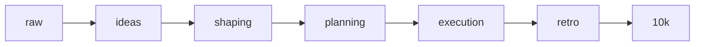

import { LinkCard, CardGrid } from '@astrojs/starlight/components';

## Bored already? Just want to get started?

From the root of your project's git repo, with a clean working tree:

```sh title="Install Ang"
curl -fsSL https://github.com/zacbraddy/ang/releases/latest/download/install.sh | sh
```

Then open Claude Code in the repo and run `/bootstrap-repo`. 🎉

## So what does Ang actually do?

Ang takes your work from a half-baked thought to shipped code, one small, focused session at a time. Each stage of its funnel answers exactly one question, the context library only ever hands your agents what the task in front of them needs, and you make every call that matters. Don't like how I've done something? Ang works great out the box but if you want to see it work different then go ahead and change it, Ang dares you! It'll even help you bend it until it's yours.

Here's the funnel your work flows through. Half-baked thoughts go in the top, and shipped code plus a slimmed-down truth about your project (`10k`) come out the bottom:



## Not sure what to read first? Try these...
<CardGrid>
  <LinkCard title="🚀 Start here" description="Install Ang, run your first loop, or try it alongside the framework you already use." href="start-here/quick-start/" />
  <LinkCard title="🧠 Concepts" description="The funnel, the context library, triggers, streams and how to bend Ang to fit you." href="concepts/funnel/" />
  <LinkCard title="⌨️ Commands" description="Every command, grouped by what you're trying to get done." href="commands/funnel/" />
</CardGrid>
