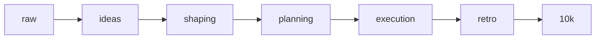

Got Ang installed, bootstrapped and Claude Code restarted? Lovely. Now it's time to take one thing all the way round the loop, so you can see what each command hands you and where it all ends up. This isn't a toy tutorial either: it's the same loop I run every day, and it's how Ang itself gets built.

To make this a bit less abstract, we'll follow one running example the whole way through: your users keep asking for **dark mode**, and you've got a hunch about it but no plan. Of course, that's just an example for this page. When you run your own first loop, feel free to swap in whatever's actually on your mind.

There are two habits that make the loop work, and they're worth getting into from day one:

- **One command per fresh session.** Each stage answers exactly one question, so the agent's context only has to hold what that question needs. This keeps your agents sharp and stops them going off the deep end.
- **Review and commit between steps.** Ang always leaves its changes unstaged, so that the final say on what gets committed, and in what shape, is always yours. The idea is that you review the changes and stage the ones you're happy with. If you then want an agent to make a few tweaks before you commit, go for it. It'll leave those tweaks unstaged too, and because you already staged the first round, what's unstaged is *only* the second round. So if an agent does anything weird off the back of your steer, that's fine: drop the unstaged edits, or get it to have another try. You don't have to accept any follow-up edits until you're happy with them, and when you are, you stage those as well. Once everything staged is something you're happy with, you're ready to commit!

## 🌀 What's this funnel, then?

Ang's workflow is all about taking loose, unstructured, unfiltered, unvetted and perhaps even irrelevant thoughts, facts and other bits of input, and feeding them into what we call the funnel.

It's not unlike other funnels you might have heard of, like a sales funnel. Loads of inputs go in the top, and as they work their way down they get refined, shaped and otherwise embellished until you've got the thing you were after. A sales funnel turns leads into customers. Ang's funnel turns all sorts of raw input that might matter to your software project into working software.

Here's the whole funnel at a glance, and then we'll walk through it step by step:

## 📝 1. Raw: get it out of your head

Every loop starts with a thought. You put that thought into the system by dropping a note in `project-context/raw/`. It can be anything: a single sentence, a pasted Slack thread, a link, whatever's rattling around. Something like "Users keep asking for dark mode. Do they mean it, or is it three loud people?" in a file called `dark-mode.md` is perfect.

Personally, I've started more than one greenfield product by spending multiple business days scrawling every possible thought, ambition and worry about what I'm planning to build into a single gigantic markdown file! In fact, that's **exactly** how I started the Ang repo. If you want to observe the chaotic thoughts of a mad software developer, feel free to go dig it out of the git log. Be warned though, when I wrote it I didn't know I'd have an audience, so reader discretion is advised!

The point is, don't worry about making it tidy, too long, too short, or anything else. For Ang to make something useful out of it, the raw file merely needs to exist. Half-baked is exactly what Ang has been told to expect in `raw/`, and it's been told not to judge. Or at least, it hasn't judged me yet! And if Ang can't work out why you dropped a file in there, it'll just ask you.

Once your file is drafted up, commit it. That stores the original in your git history, so if a future agent ever feels the need to go right back to the source, it can. These files are usually "written on the back of a napkin" quality anyway, so Ang deletes them once they're processed and trusts git to keep the originals. If you forget to commit before the next step, Ang will remind you.

## 💡 2. `/ideate`: turn it into ideas

Run `/ideate`. Ang reads your raw files, pulls out the separate threads in them, and proposes what to do with each one, five at a time. A thread might become a new idea, get folded into work that's already in flight, get parked until something specific happens, and so on. You talk it through and agree the plan.

What you get back is an idea folder at `project-context/ideas/dark-mode/`, with its open questions (Ang calls them "unknowns") listed in priority order, and the processed raw file deleted.

If you've clearly already decided to build something and only the *how* is still open, Ang can fast-track it straight to shaping. In that case you'd skip the next step.

## 🔎 3. `/refine-ideas`: is it worth doing?

Run `/refine-ideas`. Ang picks the idea that most needs attention (or the one you name), then answers **one** unknown, such as "do users actually want this, or is it just the loud three?". It'll do that through research, by asking you, or both. Sticking to one unknown per session keeps the answer focused and properly backed by real sources.

What you get back is the findings in `ideas/dark-mode/ideas-content/`, the unknown turned into a known, and a verdict on whether we know enough to start shaping. If we do, the idea moves to `project-context/shaping/dark-mode/`. If not, you run it again on the next unknown.

## 🧪 4. `/shape-ideas`: how could we do it?

Run `/shape-ideas`. Here Ang picks **one** "how could we" unknown, like "CSS variables, or a theme provider?", and proposes how to answer it: a throwaway spike, an experiment, some research, or a chat with you.

What you get back is the results in `shaping/dark-mode/shaping-content/` (spikes live in `spikes/`), any decision it settled, and a verdict on whether we know enough to plan. Once it's ready, the item gets marked `ready-for-planning`, but it stays in `shaping/` until you group it into an epic.

## 🧭 5. `/plan-epic`: how are we actually doing this?

Run `/plan-epic`. Ang looks at all the shaping items that are ready and groups them into one epic, which is an outcome you can deliver as a unit.

Sometimes the items will still have unknowns at this point that need making known before we can start building. That's on purpose. We are, after all, actively avoiding navel gazing, and sometimes an unknown only becomes answerable once several shaped ideas come together and give it the full context. So each later `/plan-epic` session works through one chunk of what's left: a planning question, a section of the plan, or a C4 diagram.

At the end of that series of sessions, what you get back is an epic folder at `project-context/planning/<epic>/` with a `plan.md` (scope, approach, risks and success measures) and, for technical work, C4 diagrams in `c4/`. I say "for technical work" because Ang can also help you with the parts of your software project that aren't technical at all, like running a marketing campaign for your new product.

Once the plan holds up, it moves to `project-context/execution/<epic>/`.

## 🔪 6. `/break-down-epic`: slice it up

Run `/break-down-epic`. What you get back is small, ordered stories in `execution/<epic>/stories/`, each with an owner (an agent, you, or both of you) and its dependencies.

## 📋 7. `/write-story`: what does done look like?

Run `/write-story`. Ang takes the next draft story and turns it into a spec. You get back the story with its "done when" evidence, acceptance criteria and a test plan (or a step-by-step guide, if the story is yours to do), marked `ready`.

Review it, stage it, and bring up any concerns or edits with the agent. When you're happy, commit the story file.

## 🔨 8. `/implement-story`: build it

Run `/implement-story`. If the story belongs to an agent, Ang builds it test-first: a failing test, make it pass, tidy up, for every acceptance criterion. If it's yours, Ang preps everything it can and walks you through it one step at a time.

You get back the work, unstaged, with the story marked `implemented`. Look it over, and when you're happy, **stage it**. But just for this step, don't commit yet! The next step treats those staged changes as the implementation it should be reviewing, so that we're not committing code that hasn't been reviewed and might still have issues the review would catch.

It's cool if you're on autopilot and commit by accident, I've done it more than once. Ang will notice there's nothing staged and ask you what it should be reviewing.

## 👀 9. `/review-story`: a fresh pair of eyes

Run `/review-story` in a new session, so that the reviewer isn't the same agent that wrote the code it's judging. It reviews the staged work against the story and the plan.

You get back a `## Review` section in the story, with findings ranked must-fix, should-fix and nit. Ang recommends which ones it thinks are worth a fix and which you can afford to let slide, each with a quick reason, but it won't make the decision for you. You pick which ones to fix, and it applies them **unstaged**, so you can compare its fixes against the original work before you commit. The story gets marked `done`.

Once you've committed, it's back to step 7 for the next story, and round you go until every story in the epic is done.

## 🧹 10. `/retro`: what's true now?

Once every story in the epic is done, run `/retro`. Ang digs through the whole epic and proposes what's now true and worth keeping, five changes at a time, plus any follow-up ideas and workflow improvements it spotted along the way.

What you get back is `project-context/10k/` updated with what delivery proved, and with what's now true in the codebase and the software it makes.

And if the epic turned up anything interesting to follow up on, or knock-on work you didn't want to do mid-flow so you could stay focused on the delivery at hand, Ang doesn't just drop it on the floor! Those get written to `raw/`, ready for your next `/ideate` whenever you are.

Once you've reviewed and committed all that, Ang deletes the epic folder in a commit of its own. That might feel weird, but think about it: the work is done, so the real truth of the implementation lives in the code now. Ang doesn't need it re-explained by out-of-date markdown files, and anything the code can't say is now captured in `10k/`, telling Ang what the 1s and 0s can't. And even if all that weren't true, git keeps the full history anyway. Keeping the context in your filesystem slim and current is what keeps your Ang agents sharp and supremely useful.

## 🎉 And round we go

That's one full loop! A hunch in `raw/` turned into shipped work, and `10k/` now knows dark mode exists and why it was built the way it was. Your next raw note starts the next loop.

If you want the detail on each command, they're all on [Commands: the funnel](../../commands/funnel/). If you'd rather understand the *why* behind the stages, start with [The funnel](../../concepts/funnel/).
