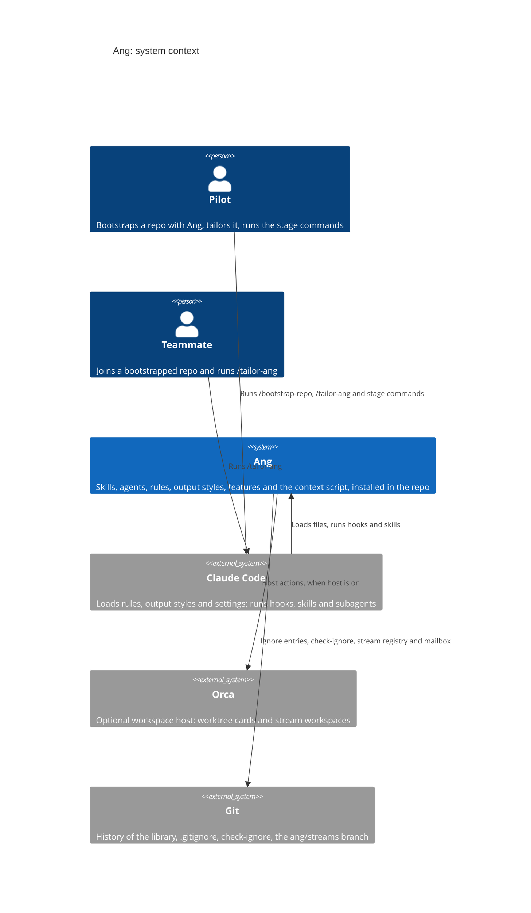

# C4 level 1: context

## Summary
Ang is a set of files installed inside one repo and run by Claude Code. The pilot bootstraps the repo and works through the stage commands. A teammate who joins a bootstrapped repo runs `/tailor-ang` to set their own name, host, output style and personal rule without touching committed files. Ang writes only inside the repo: its own files, the context library and the repo `.gitignore`. Orca is an optional host. Drawn from `src/.claude/` as of 2026-11-16.

## Diagram

## Elements
| Element | Role |
|---|---|
| Pilot | The person running Ang, named through the optional `pilot` feature ([ADR 0004](/project-context/10k/technical/adrs/0004-pilot-identity-hook-injected.md)) |
| Teammate | Same as the pilot, minus bootstrap: `/tailor-ang` runs on its own |
| Claude Code | The only harness ([ADR 0001](/project-context/10k/technical/adrs/0001-claude-code-harness-orca-optional.md)). `settings.local.json` beats `settings.json`; rules have no precedence between them |
| Orca | On only when `ang.local.json` names it and the session detects it |
| Git | The archive for deleted library docs. Ang appends to the repo `.gitignore`, `validate` runs `git check-ignore`, and streams keep their registry on the `ang/streams` branch |

## Related
- [Containers](2-containers.md)
- [Project structure](/project-context/10k/technical/project-structure.md)
- [What Ang is](/project-context/10k/product/what-ang-is.md)
