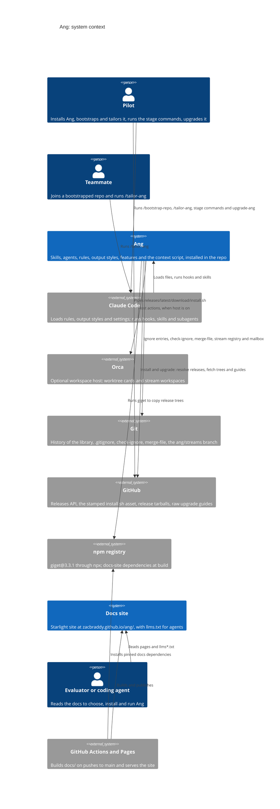

# C4 level 1: context

## Summary
Ang is a set of files installed inside one repo and run by Claude Code. The pilot bootstraps the repo and works through the stage commands. A teammate who joins a bootstrapped repo runs `/tailor-ang` to set their own name, host, output style and personal rule without touching committed files. The pilot installs Ang by piping a release's `install.sh` and upgrades it with `upgrade-ang`; both fetch from GitHub. Ang writes only inside the repo: its own files, the context library, the repo `.gitignore`, the merged `.claude/settings.json` with its `.pre-ang` backup, and the `.claude/ang/version.json` record. Install and upgrade also use OS temp folders, removed on exit. Orca is an optional host. Separately, the docs site at `https://zacbraddy.github.io/ang/` is built from the repo's `docs/` by GitHub Actions and served by GitHub Pages; people and agents (through `llms.txt`) read it to choose and run Ang. Drawn from `src/.claude/`, `install.sh` and `docs/` as of 2026-11-23.

## Diagram

## Elements
| Element | Role |
|---|---|
| Pilot | The person running Ang, named through the optional `pilot` feature ([ADR 0004](/project-context/10k/technical/adrs/0004-pilot-identity-hook-injected.md)) |
| Teammate | Same as the pilot, minus bootstrap: `/tailor-ang` runs on its own |
| Claude Code | The only harness ([ADR 0001](/project-context/10k/technical/adrs/0001-claude-code-harness-orca-optional.md)). `settings.local.json` beats `settings.json`; rules have no precedence between them |
| Orca | On only when `ang.local.json` names it and the session detects it |
| Git | The archive for deleted library docs. Ang appends to the repo `.gitignore`, `validate` runs `git check-ignore`, the upgrade runs `git merge-file`, and streams keep their registry on the `ang/streams` branch |
| GitHub | Where releases live. A default install makes no API call (the asset is stamped); a tag override and the upgrade resolve releases through the API, and the upgrade fetches guides raw at the target tag ([ADR 0005](/project-context/10k/technical/adrs/0005-install-by-copy-in-from-releases.md), [ADR 0006](/project-context/10k/technical/adrs/0006-upgrade-by-three-way-merge.md)) |
| npm registry | Serves giget, pinned and run through npx. Never a dependency of the script ([ADR 0002](/project-context/10k/technical/adrs/0002-zero-dependency-library-script.md)). Also serves the docs site's exact-pinned dependencies at build |
| Docs site | Repo-only, never installed. A pilot, an evaluator or a coding agent reads it ([ADR 0008](/project-context/10k/technical/adrs/0008-docs-starlight-on-github-pages.md), [ADR 0010](/project-context/10k/technical/adrs/0010-docs-publish-llms-txt.md)) |
| GitHub Actions and Pages | `deploy-docs.yml` builds `docs/` and publishes it; only `main` may deploy to the `github-pages` environment |

## Related
- [Containers](2-containers.md)
- [Project structure](/project-context/10k/technical/project-structure.md)
- [What Ang is](/project-context/10k/product/what-ang-is.md)
