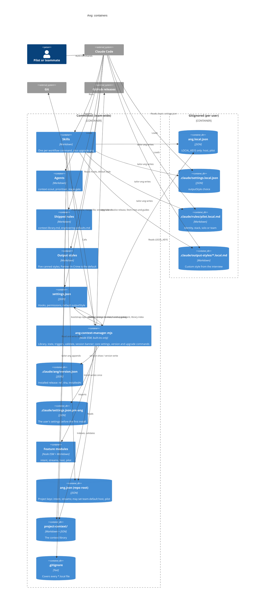

# C4 level 2: containers

## Summary
Ang's containers split into **committed, team-wide** ones (what ships, plus the project's `ang.json` and the library) and **gitignored, per-user** ones that only `/tailor-ang` writes. Claude Code loads skills, agents, rules, styles and settings directly. Hooks in `settings.json` call the one script, which merges the two config files, imports the feature modules and manages the library. The script also holds the core install and upgrade plumbing: the settings merge, the version record and the upgrade engine, which `install.sh` and the `upgrade-ang` skill call. Here a "container" is a separately loaded unit, so a group of files Claude Code loads together counts as one. Drawn from `src/.claude/` as of 2026-11-23.

## Diagram

## Containers
| Container | What it holds |
|---|---|
| Skills, agents | Workflow commands and the three subagents. Prose, run by Claude Code |
| Shipped rules | Always-on, team-neutral guidance. `pilot.local.md` adds to it, never overrides it |
| Output styles | Five canned styles, tracked. `settings.json` names Partner In Crime |
| Script | The one CLI, wired into hooks ([ADR 0002](/project-context/10k/technical/adrs/0002-zero-dependency-library-script.md)). Its `settings`, `version` and `upgrade` commands are core, not feature-gated ([ADR 0006](/project-context/10k/technical/adrs/0006-upgrade-by-three-way-merge.md)) |
| `version.json`, `settings.json.pre-ang` | Written by install, and `version.json` again by each upgrade. The user commits `version.json`. Without `version.json` the next upgrade has no merge base ([ADR 0005](/project-context/10k/technical/adrs/0005-install-by-copy-in-from-releases.md)) |
| Feature modules | Optional behaviour, invisible when off. A feature's rule is `rule.md` or `rule(value)` ([ADR 0004](/project-context/10k/technical/adrs/0004-pilot-identity-hook-injected.md)) |
| `ang.json`, `ang.local.json` | Project config, which may set any feature key, plus a per-user overlay limited to `LOCAL_KEYS` that wins for those keys ([ADR 0003](/project-context/10k/technical/adrs/0003-per-user-config-overlay.md)) |
| `project-context/` | The library: `10k/` plus in-flight stage folders |
| Per-user files | Written only by `/tailor-ang`, previewed first, and covered by unanchored `.gitignore` patterns |

The docs site (`docs/`) and its deploy workflows are repo-only and never ship, so they aren't containers of Ang; see [project structure](/project-context/10k/technical/project-structure.md).

## Related
- [Context](1-context.md)
- [Project structure](/project-context/10k/technical/project-structure.md)
