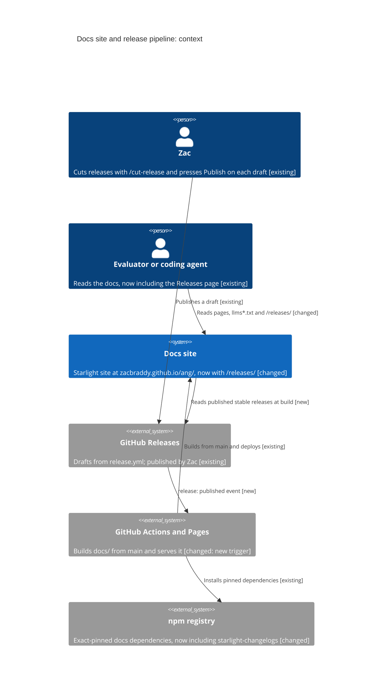

# C4 level 1: context

## Summary
The system in focus is Ang's docs site together with the release pipeline that feeds it, since both are repo-only and never ship. The epic adds two relationships and changes no actors. At build time, the docs site reads published releases from the GitHub Releases API (**new**). When Zac presses Publish on a draft release, GitHub Actions rebuilds and redeploys the site from `main` (**new**). Everything else already exists. Labels mark each element and relationship as new, changed or existing.

## Diagram

## Elements
| Element | Status | What changes |
|---|---|---|
| Zac | existing | Same Publish click. `/cut-release` gains a post-publish check that the page lists the tag |
| Evaluator or coding agent | existing | Gains a Releases page. `llms.txt` doesn't list it (plan, Out of scope) |
| Docs site | changed | A Releases page: published stable releases, newest first, one page |
| GitHub Releases | existing | Now read by the docs build. Drafts are invisible to the build's read token (k9) and the plugin drops pre-releases (d2) |
| GitHub Actions and Pages | changed | A second trigger: publishing a release dispatches `deploy-docs.yml` on `main` (d3). Only `main` may still deploy (k10) |
| npm registry | changed | Serves one more pinned dependency |

## Related
- [Containers](2-container.md)
- [Plan](../plan.md)
- [10k context](/project-context/10k/technical/architecture/1-context.md)
