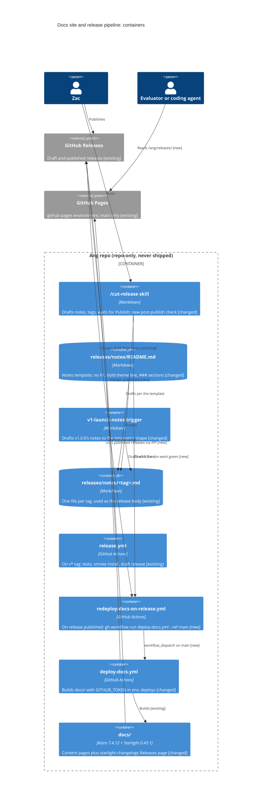

# C4 level 2: containers

## Summary
Inside the system from [level 1](1-context.md), one container is **new**: the `redeploy-docs-on-release.yml` workflow. Four are **changed**: the `docs/` site gains the plugin and its collection, `deploy-docs.yml` passes the build a read token, the release-notes template loses its h1, and the `/cut-release` skill and launch-notes trigger follow on. `release.yml`, the notes files themselves and the `github-pages` environment are **existing** and untouched. Here a "container" is a separately run or separately edited unit in the repo.

## Diagram

## Containers
| Container | Status | Change (plan scope row) |
|---|---|---|
| `releases/notes/README.md` | changed | Heading shape (1) |
| `v1-launch-notes` trigger | changed | Drafting step follows the template (2) |
| `docs/` | changed | Dependency, override, collection, plugin, sidebar entry (3–5) |
| `deploy-docs.yml` | changed | `GITHUB_TOKEN` env on the build step; permissions stay `contents: read` (6) |
| `redeploy-docs-on-release.yml` | new | The spike file, adopted as is (7) |
| `/cut-release` skill | changed | Step 8 post-publish check for stable tags (8) |
| `release.yml`, `releases/notes/<tag>.md`, `github-pages` environment | existing | Untouched (k10, k11, k12) |

## Related
- [Context](1-context.md)
- [Components](3-component.md)
- [Plan](../plan.md)
- [Project structure](/project-context/10k/technical/project-structure.md)
