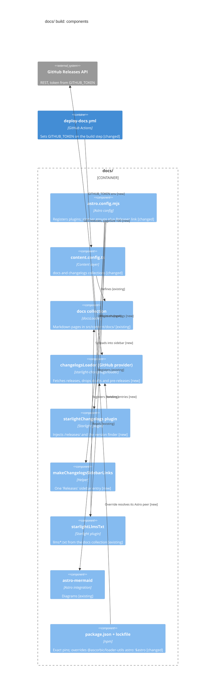

# C4 level 3: components

## Summary
Only the `docs/` container gets a component view; the workflows and the template are single files with no inner parts worth drawing. In the build, `content.config.ts` gains a second collection, `changelogs`, filled by the plugin's GitHub loader. `astro.config.mjs` registers the plugin, which adds the `/releases/` routes, and adds one manual sidebar entry. The npm override pins `@ascorbic/loader-utils`'s Astro peer to Ang's Astro, which stops npm nesting Astro 5 (k6). `starlight-llms-txt` still reads only the docs collection, so the releases pages stay out of `llms.txt`.

## Diagram

## Components
| Component | Status | Responsibility |
|---|---|---|
| `changelogsLoader` (GitHub provider) | new | Reads `zacbraddy/ang` releases at build. A failed fetch fails the production build, so the old site stays up |
| `starlightChangelogs` plugin | new | Renders one newest-first page at `/releases/` with a title and version finder; each release body sits under its version heading |
| `makeChangelogsSidebarLinks` | new | The only manual sidebar entry; content groups stay autogenerated |
| `content.config.ts` | changed | Adds the `changelogs` collection |
| `astro.config.mjs` | changed | Adds the plugin and the sidebar entry |
| `package.json` + lockfile | changed | One new pin and one `overrides` entry, inert once loader-utils widens its peer range |
| docs collection, `starlightLlmsTxt`, `astro-mermaid` | existing | Untouched |

## Related
- [Containers](2-container.md)
- [Code](4-code.md)
- [starlight-changelogs spike](../origins/docs-releases-page/shaping-content/starlight-changelogs-spike.md)
