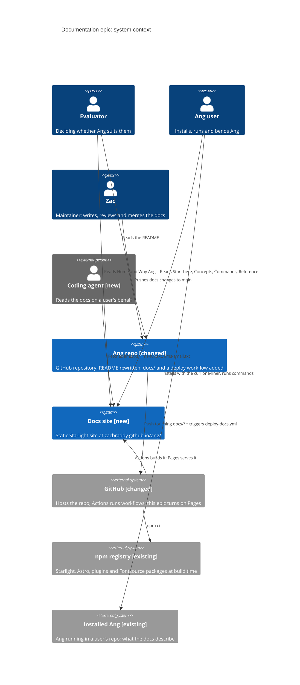

# C4 level 1: context

## Summary
This epic changes the **Ang repo** (the source repository on GitHub, not an install) and adds one new system, the **docs site**. Three kinds of reader use them: someone deciding whether Ang suits them, someone already using it, and coding agents reading `llms.txt`. GitHub Actions builds the site and GitHub Pages serves it at `zacbraddy.github.io/ang/`. Names follow the install epic's C4, which introduces GitHub and the npm registry first; if this epic lands before it, both are new here instead. The installed Ang from [10k context](/project-context/10k/technical/architecture/1-context.md) is unchanged: the docs only describe it.

## Diagram
Labels: **[new]** = added by this epic, **[changed]** = edited by it, **[existing]** = untouched, as in the install epic's C4.

## Elements
| Element | State | Role |
|---|---|---|
| Evaluator | existing reader | Lands on the README or Home. Needs to decide (bar 1 in the [page map](../information-architecture.md)) |
| Ang user | existing reader | Needs to get Ang running, use it and bend it (bars 2–4) |
| Coding agent | new | Reads the agent-readable outputs (d10) |
| Zac | existing | The only writer. Sets the Pages source to GitHub Actions once |
| Ang repo | changed | Gains `docs/`, `.github/workflows/deploy-docs.yml` and a rewritten `README.md`; nothing under `src/` changes |
| Docs site | new | About 20 pages in 6 sidebar groups ([page map](../information-architecture.md)) |
| GitHub | changed | Actions arrives with the install epic's `release.yml`; this epic adds `deploy-docs.yml` and turns on Pages (source: GitHub Actions). Free |
| npm registry | existing | Used by the install epic; here only the docs build touches it, and the shipped Ang still has no dependencies ([ADR 0002](/project-context/10k/technical/adrs/0002-zero-dependency-library-script.md)) |
| Installed Ang | existing | The source of truth for every claim on a page (k5) |

## Related
- [Containers](2-containers.md)
- [Plan](../plan.md)
- [10k context](/project-context/10k/technical/architecture/1-context.md)
