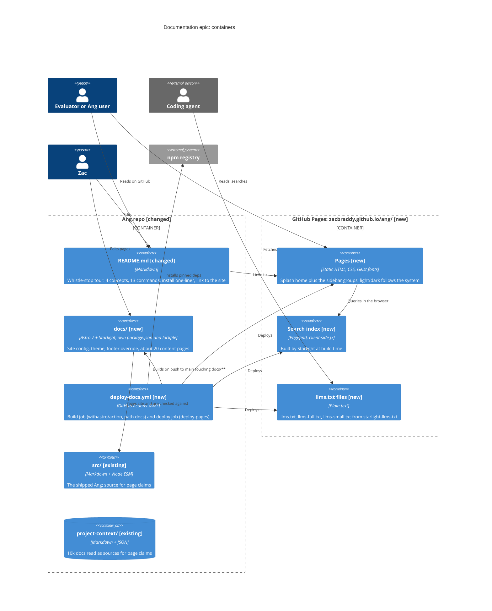

# C4 level 2: containers

## Summary
In the repo, the epic changes `README.md` and adds two containers: the `docs/` Starlight project and the `deploy-docs.yml` workflow. The `src/` shipped files and `project-context/` are read as sources and stay unchanged. The build produces three served containers on Pages: the HTML pages, the Pagefind search index and the `llms*.txt` files. A "container" here is a separately deployed or loaded unit, matching the [10k containers](/project-context/10k/technical/architecture/2-containers.md).

## Diagram

## Containers
| Container | State | Notes |
|---|---|---|
| `README.md` | changed | Ships first and alone (d1). Links to the site from day one |
| `docs/` | new | Outside `src/`, so the installer never copies it. Nothing at the repo root depends on it (candidate ADR 1) |
| `deploy-docs.yml` | new | Sits beside the install epic's `release.yml` and open-source-hygiene's CI. A failed build blocks the deploy |
| `src/` | existing | Read, never edited: docs defects become recorded work (candidate ADR 3) |
| `project-context/` | existing | Read only. README badges are open-source-hygiene's to add with its CI (d12, k17) |
| Pages, search index, llms.txt files | new | All built from `docs/` in one `astro build`; u6 checks they work under the `/ang/` base |

## Related
- [Context](1-context.md)
- [Components](3-components.md)
- [10k containers](/project-context/10k/technical/architecture/2-containers.md)
