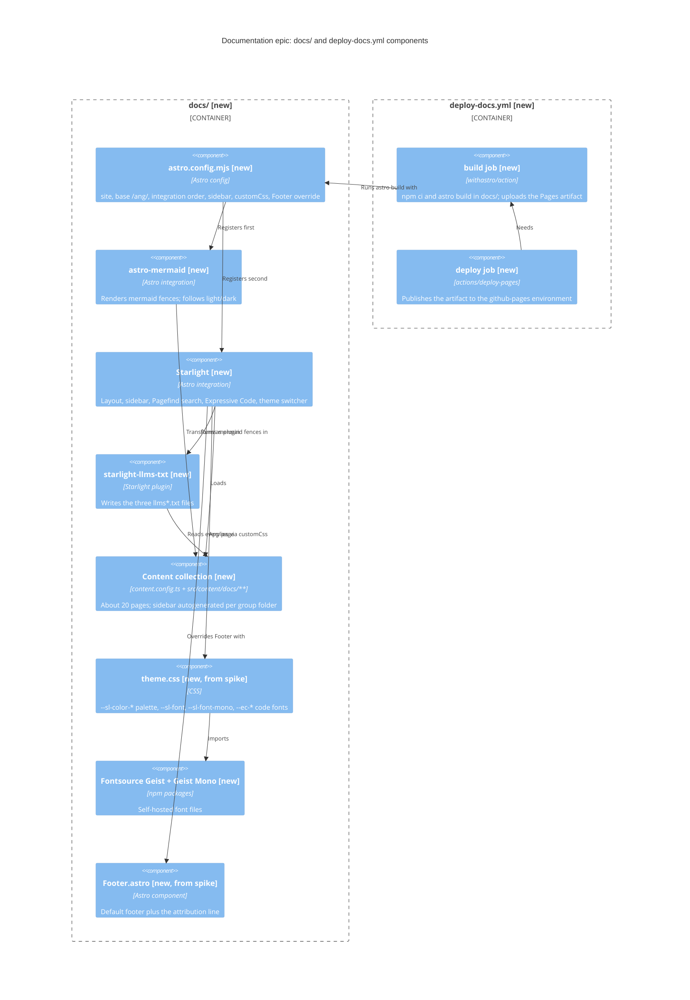

# C4 level 3: components

## Summary
Every component here is **new**: the `docs/` project and the workflow don't exist yet. `astro.config.mjs` sets the site and `/ang/` base and registers `astro-mermaid` before Starlight (d9), with `starlight-llms-txt` as a Starlight plugin (d10). Starlight reads the content collection, applies `theme.css` (palette d6 and Geist fonts d7) and swaps in the footer override for attribution. The workflow's build job runs `astro build` and its deploy job publishes the artifact. The README has no components worth drawing; its sections are listed in [code](4-code.md).

## Diagram

## Components
| Component | Responsibility | Comes from |
|---|---|---|
| `astro.config.mjs` | One place for site, base and integrations. No link-rewriting plugin: pages use relative route links (plan Approach) | Spike, trimmed |
| `astro-mermaid` | Diagrams on the funnel and streams pages | New |
| Starlight | Everything a docs layout needs, built in (k11) | Spike, upgraded to 0.43.x |
| `starlight-llms-txt` | Agent-readable output, default settings | New |
| Content collection | The pages in the [page map](../information-architecture.md), one folder per sidebar group | New; the spike's 3 sample pages are not reused |
| `theme.css` | Palette and fonts only; size, line-height and width stay at Starlight's defaults (d7) | Spike, plus font variables |
| Fontsource packages | Geist and Geist Mono, no external font requests | New |
| `Footer.astro` | Attribution to Zac and We Right Code | Spike, as-is |
| Build and deploy jobs | Build gate and publish (test strategy) | Spike's `deploy.yml`, moved into place |

## Related
- [Containers](2-containers.md)
- [Code](4-code.md)
- [Starlight spike](../origins/docs-website/spikes/starlight/README.md)
