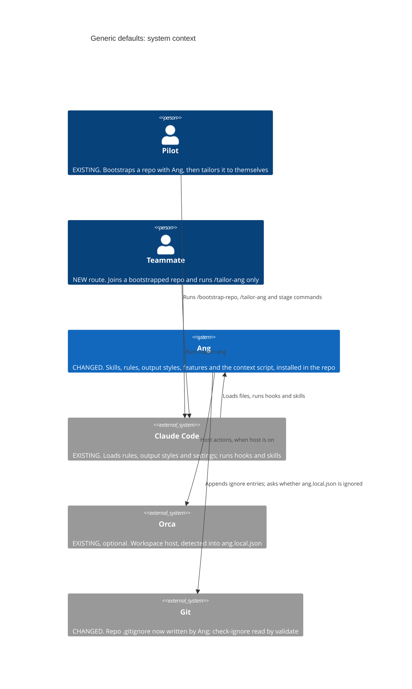

# Generic defaults C4 level 1: context

## Summary
Ang (the workflow framework) stays a set of files inside one repo, run by Claude Code. The epic changes Ang itself and gives a second person a route in: a teammate who joins an already bootstrapped repo runs `/tailor-ang` to set their own pilot name, host, output style and personal rule, without touching committed files. Git gains a repo `.gitignore` that Ang now writes to. Nothing outside the repo is written (decision d6).

## Diagram

## What changes at this level
| Element | Status | Change |
|---|---|---|
| Pilot | existing | Gets a generic default experience, then tailors it; no longer inherits Zac's config |
| Teammate | new route | `/tailor-ang` is re-runnable on its own (d5) |
| Ang | changed | See [containers](2-containers.md) |
| Claude Code | existing | Same mechanisms: rules, output styles, `settings.local.json` beating `settings.json` (k7) |
| Orca | existing | Only where `host` is configured moves (into `ang.local.json`) |
| Git | changed | Ang writes the repo `.gitignore`; `validate` runs `git check-ignore` |

## Related
- [Containers](2-containers.md)
- [Plan](../plan.md)
- [Epic hub](../README.md)
- [ADR 0001: Claude Code harness, Orca optional](/project-context/10k/technical/adrs/0001-claude-code-harness-orca-optional.md)
