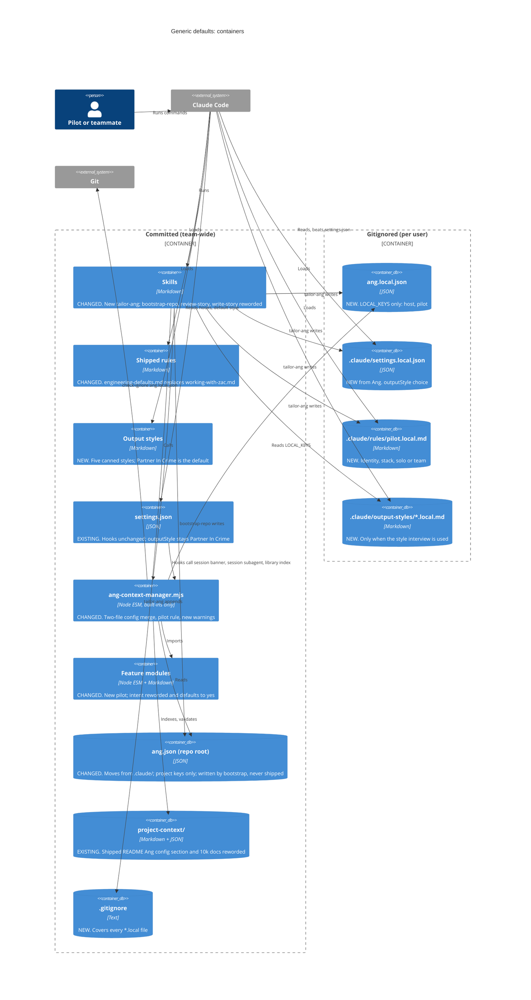

# Generic defaults C4 level 2: containers

## Summary
Ang's containers split cleanly into **committed, team-wide** ones (what ships, plus the project's `ang.json`) and **gitignored, per-user** ones written only by `/tailor-ang`. The script reads both config files and merges them; Claude Code reads the per-user rule, style and settings files directly, with no Ang code in between. Here "container" means a deployable or separately loaded unit, so a group of files Claude Code loads counts as one.

## Diagram

## Container changes
| Container | Status | Change | Story |
|---|---|---|---|
| Skills | changed | New `tailor-ang`; `bootstrap-repo` writes root `ang.json` with project keys then invokes `/tailor-ang`; two "my rules" pointers fixed; `read-mail` path reworded | 3, 5, 6 |
| Shipped rules | changed | `engineering-defaults.md` (team-neutral) replaces `working-with-zac.md`; `context-library.md` unchanged | 3 |
| Output styles | new | Partner In Crime (committed, "ADHD" label removed), Straight Shooter, Mentor, Briefing, Pair Programmer | 4 |
| `settings.json` | existing | No change; the hooks already call the script | none |
| Script | changed | See [components](3-components.md) | 1, 2 |
| Feature modules | changed | New `pilot` with `rule(value)`; `intent` messages name the new path and its bootstrap default becomes yes; `streams` conventions reworded | 1, 2 |
| `ang.json` | changed | Moves to the repo root; Ang ships none (d11); this repo gets its own, replacing the `src/` symlink (d12) | 1, 6 |
| `project-context/` | existing | Shipped README Ang config section, `10k/technical/project-structure.md` and ADR 0001 reworded | 6 |
| `.gitignore` | new | Unanchored `ang.local.json`, `settings.local.json`, `*.local.md` so symlinked `src/` paths are covered | 1, 5 |
| `ang.local.json` | new | Merged over `ang.json` for `LOCAL_KEYS` only (d13) | 1 |
| `settings.local.json` | new from Ang | Holds `outputStyle` when the pilot picks something other than the default | 5 |
| `pilot.local.md` | new | Additive personal rule from the 3-question interview (d16) | 5 |
| `*.local.md` styles | new | Written by the 5-question style interview (d14) | 5 |

## Related
- [Context](1-context.md)
- [Components](3-components.md)
- [Config move blast radius](../config-move.md)
- [Canned output styles](../output-styles.md)
- [Plan](../plan.md)
