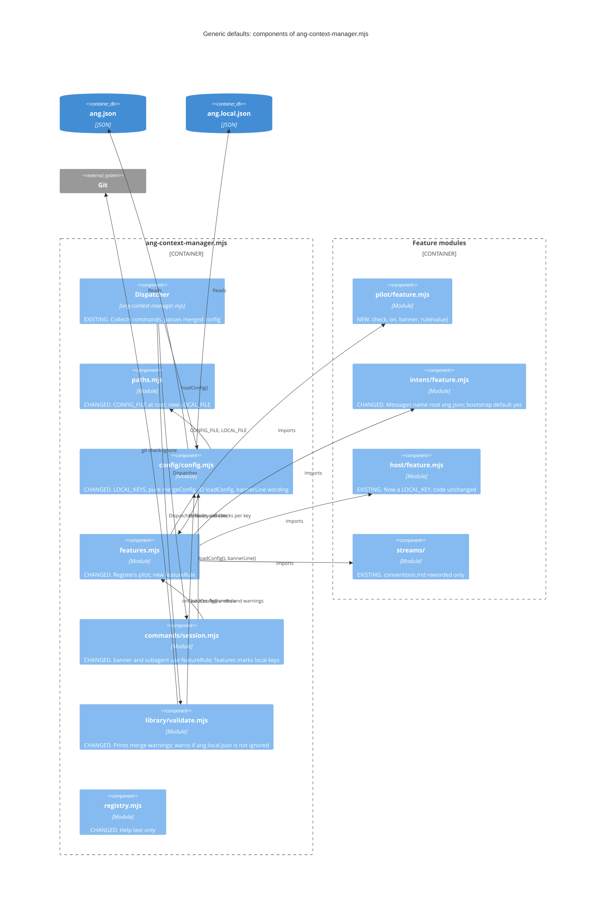

# Generic defaults C4 level 3: components

## Summary
Only the script container has code-level components worth drawing; skills, rules and styles are prose. The change concentrates in `config.mjs`: a pure `mergeConfig` holds every merge rule and the `LOCAL_KEYS` filter, and a thin `loadConfig` does the IO for both files. `features.mjs` gains the pilot feature and `featureRule`, `session.mjs` uses it for both hooks, and `validate.mjs` surfaces merge warnings plus a gitignore check. The dispatcher, registry logic, items, state, tags and triggers are untouched.

## Diagram

## Component changes
| Component | Status | Responsibility after the epic | Story |
|---|---|---|---|
| Dispatcher | existing | Unchanged: `loadConfig().config` now returns the merged config | none |
| `paths.mjs` | changed | Builds `CONFIG_FILE` (root `ang.json`) and `LOCAL_FILE` (root `ang.local.json`) | 1 |
| `config/config.mjs` | changed | Owns `LOCAL_KEYS` and every merge rule; the only reader of either config file | 1 |
| `features.mjs` | changed | Registers `pilot`; `featureRule` prefers a feature's `rule(value)` over its `rule.md` | 2 |
| `commands/session.mjs` | changed | `banner` and `subagent` print `featureRule` output; `features` marks `LOCAL_KEYS` as set by `/tailor-ang` so bootstrap skips them | 1, 2 |
| `library/validate.mjs` | changed | Prints `loadConfig` warnings; warns when `ang.local.json` exists and isn't ignored | 1 |
| `registry.mjs` | changed | Help text names both files | 1 |
| `pilot/feature.mjs` | new | Promoted from the [spike](../origins/generic-personal-defaults/spikes/pilot-feature/README.md) unchanged | 2 |
| `intent/feature.mjs` | changed | Path wording; `bootstrap.default` becomes `true` (d11) | 1 |
| `host/feature.mjs` | existing | Now listed in `LOCAL_KEYS`; no code change | 1 |
| `streams/` | existing | `conventions.md` wording only | 1 |

## Related
- [Containers](2-containers.md)
- [Code](4-code.md)
- [Config move blast radius](../config-move.md)
- [Pilot feature spike](../origins/generic-personal-defaults/spikes/pilot-feature/README.md)
