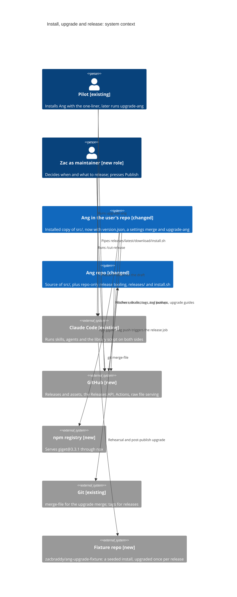

# C4 level 1: context for install, upgrade and release

## Summary
This epic adds a second person and three outside systems to [Ang's context](/project-context/10k/technical/architecture/1-context.md). **Zac, as maintainer,** cuts releases from the Ang repo with `/cut-release`. **GitHub** hosts the releases, runs the release job and answers tag lookups. **npm** serves giget, which copies `src/` into the user's repo. The **fixture repo** is where each release's upgrade is rehearsed. The user's side of Ang changes: it can now be installed with one line and upgraded with `upgrade-ang`. Orca, teammates and the streams branch are unaffected and left out.

Status labels: **[new]** is built by this epic, **[changed]** exists and gains behaviour here, and **[existing]** is drawn only for context.

## Diagram

## Elements
| Element | Status | Role in this epic |
|---|---|---|
| Pilot | existing | Same person as in 10k. New touchpoints: the one-liner and `upgrade-ang` |
| Zac as maintainer | new role | Makes every release decision: when (d18), which version (d23), the go before push (d19) and the Publish click |
| Ang in the user's repo | changed | Gains `.claude/ang/version.json`, `settings merge`, the `upgrade` command group and the `upgrade-ang` skill |
| Ang repo | changed | Gains repo-only tooling that never ships: `/cut-release`, `release-scout`, root `scripts/`, `releases/`, `install.sh` and the release workflow (d24) |
| Claude Code | existing | The only harness ([ADR 0001](/project-context/10k/technical/adrs/0001-claude-code-harness-orca-optional.md)), on both sides |
| GitHub | new | Draft and published releases with the stamped `install.sh` asset (d16), `GET /releases/tags/{tag}` for overrides (d28), Actions for the release job (d21), `raw.githubusercontent.com` for upgrade guides (k12). Immutable releases and a `v*` tag ruleset are on (d30) |
| npm registry | new | giget pinned at 3.3.1, run through `npx` (d6). Node with npm/npx is the documented prerequisite (k9) |
| Git | existing | `git merge-file` does the per-file three-way merge (d9). Release tags are `v1.0.0-rc.N`, then semver (d17) |
| Fixture repo | new | Created and seeded by Zac from the `rc.1` install (k13, k17); rehearses each release's upgrade from the previous one (d22, d27) |

## Related
- [Containers](2-containers.md)
- [Plan](../plan.md)
- [Release process proposal](../release-process-proposal.md)
- [10k context](/project-context/10k/technical/architecture/1-context.md)
