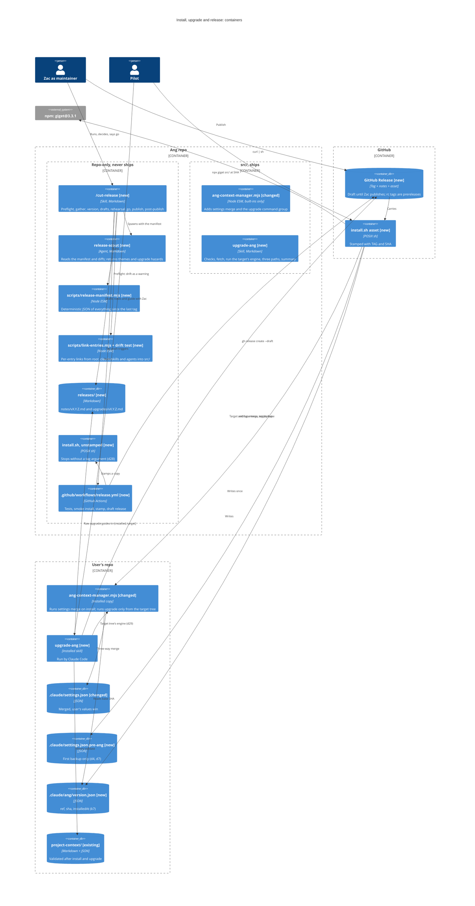

# C4 level 2: containers for install, upgrade and release

## Summary
The containers sit in three places:
- **The Ang repo:**
  - What **ships** is still only `src/`. Inside it, the library script and the new `upgrade-ang` skill change.
  - What's **repo-only** sits beside `src/` and never ships (d24): `/cut-release`, `release-scout`, the root `scripts/`, `releases/`, the unstamped `install.sh` and the release workflow.
- **GitHub:** holds each release and its stamped `install.sh` asset.
- **The user's repo:** gains `version.json` and a one-off settings backup.

The fixture repo is a user's repo like any other, so it isn't drawn separately. Containers from [10k level 2](/project-context/10k/technical/architecture/2-containers.md) that this epic doesn't touch (rules, styles, features, per-user files) are left out.

## Diagram

## Containers
| Container | Status | Lives | What it does |
|---|---|---|---|
| `/cut-release` | new | Repo-only `.claude/skills/` | Runs a release with Zac from preflight to post-publish (d15, d18, d19, d23). Commits, tags and pushes only on a go asked for right then |
| `release-scout` | new | Repo-only `.claude/agents/` | Keeps diff reading out of the main session; feeds the coverage check (d20) |
| `scripts/release-manifest.mjs` | new | Root `scripts/` | `src/` paths with rename similarity, commits, archived epics, `10k/` changes, CLI and settings diffs since the last tag. Same tags, same output (d20) |
| `scripts/link-entries.mjs` + drift test | new | Root `scripts/` | Creates missing per-entry links, removes dangling ones, re-runs as a no-op. The test fails on drift in the release job; preflight warns (k16) |
| Root `.claude/skills`, `.claude/agents` | changed | Repo root | From whole-folder symlinks to real folders of per-entry links plus repo-only entries (d24). Drawn in [level 3](3-components.md) |
| `releases/` | new | Repo root | Human notes (the Release body, d25) and agent-facing upgrade guides, one of each per release (k12) |
| `install.sh` (repo copy) | new | Repo root | Unstamped. Without a tag it stops and points at the release-asset one-liner (d28) |
| `release.yml` | new | `.github/workflows/` | On `v*` push: `node --test`, smoke install, stamp, draft release (d21). Separate from open-source hygiene's CI |
| GitHub Release + asset | new | GitHub | Drafts are invisible to `releases/latest` until Zac publishes. Immutable once published (d30) |
| `ang-context-manager.mjs` | changed | `src/`, installed | Gains core (non-feature-gated) `settings merge` and `upgrade` commands, Node built-ins only ([ADR 0002](/project-context/10k/technical/adrs/0002-zero-dependency-library-script.md)) |
| `upgrade-ang` | new | `src/.claude/skills/` | The judgement half of an upgrade: rereads clean merges, resolves conflicts, confirms risky merges with the user on guided routes and gives the size warning (d9, d13, d26) |
| `settings.json` | changed | User's repo | Merged on install and upgrade. `outputStyle` conflicts are skipped (k15) |
| `settings.json.pre-ang`, `version.json` | new | User's repo | The backup is written once; the version record is rewritten by each upgrade |

## Related
- [Context](1-context.md)
- [Components](3-components.md)
- [Plan](../plan.md)
- [10k containers](/project-context/10k/technical/architecture/2-containers.md)
