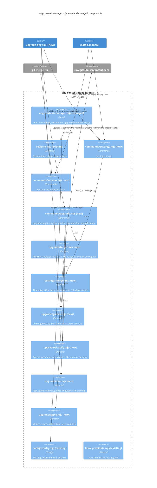

# C4 level 3: components for install, upgrade and release

## Summary
The library script keeps its shape: `commands/*.mjs` declare commands and domain modules sit in sibling folders. This epic adds three command files and two domain folders:
- `settings/` holds the one three-way JSON merge that install and upgrade share (k15).
- `upgrade/` holds the deterministic half of an upgrade: guide chaining and parsing, file classification and sizing the job into a route.
- `version` reads and writes `version.json`, so install and upgrade write the record the same way.

All three are core commands, not feature-gated, because a fresh install has no `ang.json` yet. `loadConfig` already treats a missing `ang.json` as defaults, so config is unchanged. The judgement half (rereads, conflicts, go-or-stop) stays in the `upgrade-ang` skill. `install.sh` and `/cut-release` are drawn as stages rather than components, because each is one script or skill run top to bottom.

## Library script

| Component | Status | Responsibility |
|---|---|---|
| `commands/settings.mjs` | new | `settings merge`: reads base, ours and theirs files, writes the merged `settings.json` and prints any conflicts as JSON. The base may be `none` (install) |
| `commands/version.mjs` | new | `version show` prints the record or says there is none. `version write` takes `--ref` and `--sha` and stamps `installedAt` |
| `commands/upgrade.mjs` | new | `upgrade guides` fetches and checks the chain. `upgrade plan` classifies and sizes without writing, emitting a JSON plan plus merged files in a temp folder. `upgrade apply` writes the plan's settled files |
| `settings/merge.mjs` | new | The spike's merge as a pure function. Ang-owned entries are replaced, user values kept; a base entry missing from both sides is a conflict; `outputStyle` conflicts are dropped (k15). An empty base gives exactly the install merge (d7) |
| `upgrade/guides.mjs` | new | Walks back from the target guide through `from:` lines to the installed tag, so no API call lists releases. A missing guide or a broken chain is an error. Parses Moves, Migrations, Retired and Notes for the merge; "None" means empty, and `from: none` marks the first release |
| `upgrade/classify.mjs` | new | The upgrade merge spike's categories (k8), after rewriting base paths through the guides' Moves, so a declared move isn't read as a delete. Excludes `settings.json`, `version.json` and `*.local.*` |
| `upgrade/size.mjs` | new | Picks the route from the conflicted-file count. `AGENT_RESOLVES_UP_TO` and `WARN_FROM` are named constants; tuning is parked until users report a wrong route ([route threshold tuning](/project-context/ideas/parked.md#route-threshold-tuning), d9). No version record always means guided with warning (d8) |
| `upgrade/apply.mjs` | new | Writes and deletes working-tree files from a fully resolved plan, and refuses before writing anything if any conflict is unresolved (d26). Never stages or commits |
| Entry, registry, config, validate | existing / changed | The entry gains three imports; nothing else changes |

## install.sh stages
Run top to bottom, piped. Nothing is written before every check passes (d12).

| Stage | Status | What it does |
|---|---|---|
| Resolve target | new | Stamped asset: `TAG` and `SHA` are baked in, no API call. Tag argument: `GET /releases/tags/{tag}`. Unstamped with no tag: stop and print the one-liner (d28) |
| Checks | new | node ≥ 26 and npx, inside a git repo at its root, clean tree, Ang not installed, no collisions, `settings.json` parses, ref resolved (says which of network, rate limit or bad ref failed) |
| Copy in | new | `npx giget@3.3.1 gh:zacbraddy/ang/src#<SHA>` into a temp folder, then into the repo, so a failed fetch writes nothing |
| Settings | new | Back up to `settings.json.pre-ang` once, then the copied tree's own `settings merge` with an empty base |
| Record and report | new | `version write --ref TAG --sha SHA`, then the version, location and next step |

## upgrade-ang stages
| Stage | Status | Deterministic or judgement |
|---|---|---|
| Checks (d13): clean tree, prerequisites, then `upgrade target` from the installed engine: target resolves (latest stable by default) and is newer | new | Deterministic: `upgrade target` |
| Fetch target and base trees with giget into a temp folder | new | Deterministic |
| `upgrade guides`, then `upgrade plan`, from the **target** tree | new | Deterministic |
| Guided with warning: show the count and a risk assessment, Pilot goes ahead or stops | new | Judgement, the Pilot's |
| Resolve: reread clean merges against upstream's diff and Retired entries, resolve conflicts, check conflict-deletes as moves. On guided routes, confirm only the risky merges with the Pilot ([upgrade routes](../upgrade-routes.md)) | new | Judgement, the agent's; the Pilot's on risky merges |
| `upgrade apply`, `settings merge`, `version write` | new | Deterministic |
| `library validate`, shipped tests, summary (from/to, clean vs judgement, how to review or discard). Changes unstaged. On a failure it can't recover, it reports what went wrong and hands over: fix by hand or discard | new | Deterministic, then a report |

## Repo-only release tooling
| Component | Status | Responsibility |
|---|---|---|
| Root `.claude/skills/`, `.claude/agents/` | changed | Real folders: one relative link per `src/` entry plus the repo-only `cut-release` and `release-scout` (d24). `.claude/scripts` stays a whole-folder link |
| `scripts/link-entries.mjs` | new | Plans and applies per-entry links; a no-op on re-run |
| `scripts/link-entries.test.mjs` | new | Fails on a missing or dangling link. Runs in the release job |
| `scripts/release-manifest.mjs` | new | Builds the manifest from git alone (d20) |
| `/cut-release` | new | Stages 1 to 8 of the [proposal](../release-process-proposal.md), for the steady state only: no branch for `rc.1` or v1.0.0 (d38, d39) |
| `release-scout` | new | Returns themes, user-facing vs internal, and upgrade hazards; every manifest entry maps to notes, guide or an internal list |
| `release.yml` | new | `node --test 'src/.claude/**/*.test.mjs' 'scripts/*.test.mjs'` on Node 26, stamp, smoke install with the stamped copy, `gh release create --draft` (with `--prerelease` for rc tags) |

## Related
- [Containers](2-containers.md)
- [Code](4-code.md)
- [Settings merge spike](../settings-merge-spike.md)
- [Upgrade merge spike](../origins/install-uninstall-update/shaping-content/upgrade-merge-spike.md)
