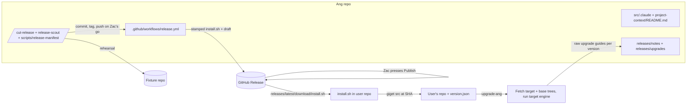

# Install, upgrade and release plan

## Summary
This epic ships three things that depend on each other, and it is done when **`v1.0.0-rc.2` is cut by `/cut-release` and the rehearsed upgrade from `rc.1` passes**:
- **Install:** a release-asset `install.sh`, one copy-pasteable line. It checks prerequisites, copies in `src/` with giget, merges `settings.json` and writes `.claude/ang/version.json`.
- **Upgrade:** a shipped `upgrade-ang` skill. It fetches the target release, runs the *target's* merge engine, and takes one of four routes: fast, agent-resolved, guided or guided with warning ([upgrade routes](upgrade-routes.md)). It never commits.
- **Release:** a repo-only `/cut-release` skill with Zac, a `release-manifest` script, a `release-scout` agent, a tag-triggered GitHub Actions job and a seeded fixture repo for rehearsals.

All of the merge logic lives in the library script (`ang-context-manager.mjs`), with Node built-ins only ([ADR 0002](/project-context/10k/technical/adrs/0002-zero-dependency-library-script.md)). Install and upgrade share one settings merge.

## Scope
- **Repo layout for repo-only tooling (d24):** the root `.claude/skills` and `.claude/agents` become real folders with per-entry links into `src/`. A root `scripts/` folder holds the link script and `release-manifest`, and a repo-only drift test checks the links.
- **Shared merge core in the library script:**
  - `settings merge` is the three-way JSON merge from the [settings merge spike](settings-merge-spike.md). It is the install merge when the base is empty (d7, k15).
  - an `upgrade` command group: file-by-file classification and `git merge-file` (d9), reading the upgrade guides, and sizing the job into a route.
  - `version show` and `version write`, the only way install and upgrade read or write `version.json` (d35).
- **`install.sh`** at the repo root, unstamped there, which stops without a tag (d28). It runs every check in d12, backs up settings (d4), merges settings, writes `version.json`, and prints the version, location and next step.
- **`upgrade-ang` skill** (ships in `src/`): the checks in d13, a fetch of the target and base trees, the target's engine (d29), the three paths (d9, d26) and a closing summary.
- **Release process:** `releases/notes/` and `releases/upgrades/` (k12), `release-manifest`, `release-scout`, `/cut-release` (d15, d18 to d20, d23, d25), and the release workflow in `.github/workflows/` (d16, d21).
- **Stories Zac carries out by hand, each guided by a story:**
  - turning on immutable releases and the `v*` tag ruleset (d30);
  - creating and seeding the fixture repo from an `rc.1` install (k13, k17, d22).
- **Cutting `v1.0.0-rc.1` and `rc.2`** with the finished process, as its proof.

## Out of scope
- An uninstall command (d2). Removing Ang by hand belongs in the docs, which the documentation stream owns.
- A local changelog (d10), partial upgrades (d26), rehearsals that skip releases (d27) and pre-open-source upgrade paths (d8). The first three are parked.
- Cutting `v1.0.0` itself. It marks the close of the delivery intent (d17), which is more than this epic.
- The README quick start and the docs site. This epic hands them the one-liner (`releases/latest/download/install.sh`), and `repo-readme` and the documentation stream write them.
- Open-source hygiene's CI, `package.json`, linting and `.node-version`. The release job runs `node --test` directly, so it doesn't wait for them (see Risks).
- Checksums, signing, `CHANGELOG.md`, commit conventions and release bots (k11, [proposal: not proposed](release-process-proposal.md)).

## Approach
### How the pieces connect

### Install
- **Two ways to get the script:**
  - the README one-liner fetches the release asset, stamped with `TAG` and `SHA`, so a default install makes no API call (d16, d28);
  - `| sh -s -- <tag>` calls `GET /releases/tags/{tag}`, which resolves the SHA and confirms the tag is a published release (d14).
- **Order:** all d12 checks first, before anything is written. Then giget copies `src/` at the SHA (d6). Then `settings merge` runs with an empty base, after a single `.claude/settings.json.pre-ang` backup (d4, d7). Last, `version write` records `version.json { ref, sha, installedAt }` (k7, d35).
- **Settings merge:** the copied tree's own `ang-context-manager.mjs` runs it, so the install and the release it installs always agree on the merge.

### Upgrade
- **Checks first (d13):** the target exists and is newer, the tree is clean, and the prerequisites are present. A missing or unknown `version.json` goes to guided with warning (d8).
- **Fetch three trees into a temp folder with giget:** the target (theirs) at the target tag, and the base at the `version.json` SHA. The instance (ours) is the working tree. The target tree carries its own `ang-context-manager.mjs`, and the skill runs **that** engine (d29), so no separate engine download is needed.
- **Fetch every upgrade guide in (installed, target]** from `raw.githubusercontent.com` at the target tag, by following each guide's `from:` line back from the target's guide, then applying them oldest first (k12, d34). A missing guide or broken chain is an error.
- **Classify and size:** the engine sorts files into the spike's categories (k8). It applies the guides' moves before classifying, so a move is no longer read as a deletion. It then sizes the job:
  - **fast:** every change is one-sided; write and summarise;
  - **agent-resolved:** any clean merge, or a handful of conflicted files. The skill rereads clean merges against upstream's diff and the guide's Retired entries (catching semantic staleness), resolves conflicts itself, and checks conflict-deletes as possible moves. No input from the user;
  - **guided:** more conflicts. As agent-resolved, but the user confirms only the merges that risk breaking Ang or one of their customisations;
  - **guided with warning:** many conflicts, or no record. Before writing, it warns with the count and a risk assessment and the user decides, then it runs as guided. All or nothing (d26).
  - The route thresholds and the reasons behind this design are in [upgrade routes](upgrade-routes.md) (d9).
- **Settings** go through `settings merge` with the base tree's `settings.json` (k15). `outputStyle` conflicts are skipped, because `tailor-ang` owns that key.
- **Finish:** write the new `version.json`, run `library validate` and the shipped tests, and print a summary (from/to, clean vs judgement, how to review). Changes stay unstaged.

### Release
This follows the [release process proposal](release-process-proposal.md) as agreed: preflight warnings, then manifest, scout, version, drafts, rehearsal, go, CI, publish and post-publish. Zac makes every decision (d18, d19, d23).
- **No rehearsal for `rc.1`,** because no release exists to upgrade from. `/cut-release` says so and skips the step. Then the fixture is seeded from the `rc.1` install, and `rc.2` gets the first real rehearsal (proposal step 4).

## Sequencing
1. **Repo layout and link script (d24).** This comes first, because every repo-only skill, agent and script below needs a home that doesn't ship.
2. **`settings merge` and `version show`/`version write`** in the library script, test-first from the spike's four scenarios. Install and upgrade both depend on them.
3. **`install.sh`** with its checks, the tag-required repo copy and the API override. Its tests stub giget at the boundary.
4. **Release mechanics:** the `releases/` folders and the release workflow. In parallel, Zac's GitHub setup story (d30).
5. **`release-manifest`, `release-scout`, then `/cut-release`.**
6. **`upgrade` engine and the `upgrade-ang` skill.** They can start after step 2, and they ship in `rc.1`: the fixture is an `rc.1` install, so the rehearsal needs the skill already in its tree. Only the engine comes from the target (d29).
7. **Cut `v1.0.0-rc.1`.** This proves the job, the stamp, the publish flow and a live one-liner install.
8. **Fixture repo story:** Zac creates and seeds it from `rc.1` (k17).
9. **Cut `v1.0.0-rc.2` with the `rc.1` to `rc.2` rehearsal.** This is the epic's finish line, and the first end-to-end proof of the upgrade.

Steps 3 to 6 can run in parallel once step 2 lands.

## Risks
| Risk | Mitigation |
|---|---|
| An upgrade guide misses a move or migration | The manifest coverage check (d20) and the fixture rehearsal (d22). A miss after release is fixed forward with a patch (d30) |
| Clean merges that are semantically stale (k8) | Guided-merge rereads, using the guide's Retired entries |
| The route thresholds rest on two spike runs (d9) | Make them named constants. Tune them after the `rc.2` rehearsal and real upgrades |
| An agent-run merge gets a user's customisation wrong | The upgrade never commits, so the user reviews and can drop the whole changeset. Guided routes confirm the risky merges ([upgrade routes](upgrade-routes.md)) |
| `upgrade-ang` overwrites its own skill file mid-run | The engine runs from the temp target tree. The running prompt is already loaded, and the new skill applies next time |
| Running code fetched at the target tag (d29) | It's the same trust as installing that release. Fetch only published release tags (d14) |
| The fixture's seeded edits drift as `src/` evolves | Real upgrades roll it forward. Fix it in the rehearsal step when it breaks |
| Collision with open-source hygiene's CI in `.github/workflows/` | Separate `release.yml`. When hygiene lands, it can point the test step at `npm test` |
| A big v1 manifest overflows the drafting context | `release-scout` reads the diffs in its own context and returns a summary |
| giget or GitHub down mid-install | d12 checks fail early with a plain message. No files are written before the copy succeeds |

## Success measures
- **Install:** the live one-liner installs `rc.1` into a fresh repo and into an existing project with its own settings. `version.json` matches `git rev-parse` at the tag. `library init` and `library validate` pass. A re-run stops and points to upgrade.
- **No leaks:** no `*.local.*` file, `install.sh`, `releases/` or `scripts/` content appears in an installed tree (k2, k6).
- **Upgrade:** the `rc.1` to `rc.2` fixture upgrade keeps every seeded local edit and the local-only skill and agent. It leaves no conflict-delete unexplained by the guide and passes `library validate` and the shipped tests. A second run stops with "already on the target".
- **Release:** `/cut-release` takes `rc.2` from preflight to post-publish, with Zac only making decisions and never typing a git or gh command. The coverage check shows no leftover manifest entries.

## Test strategy
Every test uses `node:test`, beside the code it tests. Zero dependencies, run with `node --test`.

| Level | What | Notes |
|---|---|---|
| Unit (most) | `settings merge`: the spike's four scenarios, plus empty base equals the install merge, plus a no-op re-run | Pure function over three JSON objects |
| Unit | `version show` with and without a record, `version write` | Temp folder |
| Unit | Upgrade file classification, applying guide moves, route sizing, parsing the upgrade guide (sections, "None", missing file is an error), chaining guides by `from:` with an injected fetch | Inputs are in-memory file maps |
| Unit (repo-only) | Link drift: missing and dangling per-entry links | Lives in `scripts/`, never ships |
| Integration | `upgrade` engine over three temp git trees: one case per category, and a move declared in a guide | The spike's harness, turned into tests |
| Integration | `install.sh` against temp git repos, with `npx` stubbed on `PATH` to copy a local `src/`: every d12 check, the settings backup and merge, the version record, and no tag on the repo copy | Mocks giget and GitHub at the boundary |
| Integration (repo-only) | `release-manifest` over a temp repo with tags, renames and an archive commit | Same tags give the same manifest |
| End to end (few) | The release job's smoke install on a fresh runner repo, the post-publish live one-liner, and the fixture rehearsal | These *are* the release process; nothing extra to build |

Not tested: skill and agent prose, `gh` calls, the Actions YAML (it fails loudly) and giget itself.

## Consistency with `10k/`
These come from a `context-scout` pass over `10k/` and the other streams.

**Settled with Zac:**
- [Intent](/project-context/10k/intent.md) runs to the first public release, v1.0.0, not to the first tag. `rc` pre-releases don't end it (d31).
- The release process, fixture repo and upgrade skill fall within the "bare minimum" in [business constraints](/project-context/10k/business-constraints.md): the minimum for a process that's comfortable to maintain, not the least effort (d32).
- `upgrade-ang` is plumbing, like `install.sh` and the release pipeline, so [what Ang is](/project-context/10k/product/what-ang-is.md) stays at four features (d33).

**10k docs to update when the epic lands** (at `/retro` or `/curate-10k`):
- [Project structure](/project-context/10k/technical/project-structure.md): per-entry links, root `scripts/`, `releases/` and `.github/`. Its Node 21 note is now behind the Node 26 minimum (k9).
- [C4 context](/project-context/10k/technical/architecture/1-context.md) and containers: add GitHub (API, Releases, Actions), npm/giget and `version.json`.
- [ADR 0002](/project-context/10k/technical/adrs/0002-zero-dependency-library-script.md) says there is no install step. `install.sh` with `npx giget` is one, though the library script itself stays dependency-free. Open-source hygiene d8 already plans an amendment, so make the two agree.
- [Voice and attribution](/project-context/10k/marketing/voice-and-attribution.md): add the release notes' emoji-per-heading (d25).
- Open-source hygiene d13 ("generated GitHub Releases", stamping before tagging) is reinterpreted by d15 and d16.

**Must honour:**
- ADR 0002: `settings merge` and `upgrade` are core, non-feature-gated commands, because a fresh install has no `ang.json` key yet.
- [ADR 0004](/project-context/10k/technical/adrs/0004-pilot-identity-hook-injected.md): gitignored `*.local.*` files sit physically under `src/` here, so cut releases from git, never from disk (k2).
- [ADR 0003](/project-context/10k/technical/adrs/0003-per-user-config-overlay.md): `ang.json` and `ang.local.json` never ship.

## Candidate ADRs
The next free number is 0005.
1. **Install by copy-in:** giget pinned through npx, wrapped in a release-asset `install.sh` stamped with its tag and SHA. Installs and upgrades target published release tags only, and the repo copy is unstamped (d1, d6, d14, d16, d28).
2. **Upgrades are a file-by-file three-way merge against `version.json`:** four routes by conflict count, never committing, all or nothing, run by the target release's engine (d9, d26, d29).
3. **One three-way settings merge, in the library script,** used by install (empty base) and upgrade (k15, d7).
4. **Release notes and upgrade guides are separate per-version files** under root `releases/`, and every release gets a guide (k12).
5. **Releases are cut by a local skill with Zac:** fed by a deterministic manifest and `release-scout` with a coverage check, no commit conventions, explicit go before push, and Zac's own Publish click. The mechanics run in CI on tag push (d15, d19 to d21). This refines open-source hygiene d13.
6. **Versioning:** only `v1.0.0-rc.N` before v1, then semver as guidelines, with Zac deciding each version (d17, d23).
7. **Upgrade rehearsals run against a dedicated fixture repo,** seeded once without LLM prose and rolled forward per release (d22, k17).
8. **Repo-only skills and agents use per-entry symlinks into `src/`,** with repo-only scripts in root `scripts/` (d24).
9. **No uninstall command** (d2).
10. **Amend ADR 0002:** install needs node with npm/npx, while the library script stays dependency-free (k9, d6).

## Related
- [Epic hub](README.md)
- [Release process proposal](release-process-proposal.md)
- [Settings merge spike](settings-merge-spike.md)
- [Upgrade merge spike](origins/install-uninstall-update/shaping-content/upgrade-merge-spike.md)
- [Install script spike](origins/install-uninstall-update/shaping-content/install-script-spike.md)
- [Install and upgrade direction](origins/install-uninstall-update/shaping-content/install-and-upgrade-direction.md)
