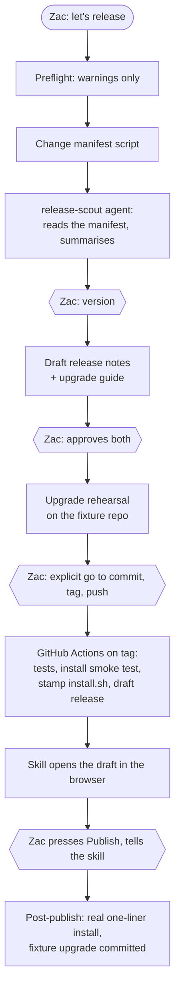

# Release process proposal

## Summary
This is the third draft, revised from Zac's review. The release process is sized for Ang as it really is: **one maintainer, now and probably for good**. It needs **support and memory** more than guard rails. It holds every step so that Zac never has to remember them, and it leaves him every decision.

- **How the work splits:**
  - A repo-only `/cut-release` skill does the thinking work with Zac, locally.
  - A **change manifest script** gives that skill every change since the last release, the same way every time, so nothing has to be found by searching.
  - When Zac pushes the tag, a small **GitHub Actions job** runs the tests and an install smoke test on a clean machine, stamps `install.sh` and opens a **draft** release.
  - **Zac presses Publish himself** in the GitHub web page.
- **Two documents per release, for two readers:**
  - **Release notes** (`releases/notes/vX.Y.Z.md`) are for humans: what the release is for and how it changes their workflow. They become the GitHub Release body.
  - **The upgrade guide** (`releases/upgrades/vX.Y.Z.md`) is for the upgrade skill: formulaic, one entry per move, migration or retirement. The skill fetches it on its own. This answers u1 (unknown 1).
- **`install.sh` ships as a release asset,** stamped with the tag and SHA (commit hash). Installs can only ever land on a published release.
- **v1.0.0 is the finish line of the delivery intent:** Ang released as a proper open-source repo. Before it come only the pre-releases needed to prove the install and upgrade process (`v1.0.0-rc.N`, release candidates). After it, Semantic Versioning (semver) applies.
- **Upgrade rehearsals run against a seeded fixture repo:** a dedicated repo installed from an earlier release, with typical local edits, whose upgrades are committed release by release.
- **Day-to-day overhead is close to zero:** no commit convention, changeset files or pull request labels. Zac turns on immutable releases once and creates the fixture repo once.

## What "bare minimum" means here
"Bare minimum" means the release process that best suits Ang's reality: comfortable and reliable for a solo maintainer. It doesn't mean the least possible effort, and it doesn't mean the large-company standard. Open-source hygiene's quality tooling went through the same thing: Zac picked off-the-shelf tools over hand-rolled ones, because "being lean here would push Ang into building its own quality tooling by hand, and that ends in sticky-tape fixes" ([quality tooling](https://github.com/zacbraddy/ang/blob/main/project-context/shaping/open-source-hygiene/ideas-content/quality-tooling.md)).

| Reality | So the process has… | …and doesn't have |
|---|---|---|
| One maintainer, now and probably for good | A skill that holds every step and every "don't forget" | Approval chains, sign-offs and release managers |
| Releases are occasional, so the steps get forgotten in between | A preflight checklist and a post-publish check | A runbook Zac has to read and follow by hand |
| You are the boss ([P2](/project-context/10k/product/first-principles.md)) | Zac decides when to release, the version, the words, the commit and the publish | Automatic releases, nudges or nags to release |
| An LLM drafts, which is not deterministic | A script that hands it the complete set of changes, plus a coverage check | Commit conventions imposed to make drafting deterministic |
| Upgrades depend on what each release declares | A machine-oriented upgrade guide, checked by a rehearsal on a fixture repo | Hand-written migration code |
| CI already exists (open-source hygiene's d2, decision 2) | Reuse it for the mechanical, repeatable steps | A heavyweight pipeline: matrix builds, signing, multi-hour runs |

## The process at a glance

The hexagons are Zac's decisions. Everything before publishing can be undone. Publishing locks the tag and the asset under immutable releases, and only Zac's own click does it.

## Step by step
### 0. Deciding to release
Zac decides when, and nothing nudges him. He runs `/cut-release` when he wants a release.

### 1. Preflight
`/cut-release` checks each of these and lists the results. They're **warnings for Zac to eyeball, not blocks**. The release is always cut from the head of main as it stands.
- On main, clean, and up to date with `origin/main`.
- **Streams with `src/` changes that aren't on main.** The skill lists each stream by name with a count, e.g. "open-source-hygiene: 9 `src/` files". Normally this is expected work for the next release. The list is there so Zac can spot one he meant to include.
- CI is green on the commit being released (`gh run list`).
- Immutable releases are on, and no draft release is left over from an abandoned attempt.
- **Link drift:** a `src/` skill or agent with no per-entry link at the root, or a dangling link. The fix is to re-run the link script in `scripts/`.
- The README's copy-paste install line matches the release-asset URL. This only checks the one-liner users run. The README says nothing about how releases are made; that lives only in the skill.

### 2. Gather: manifest script, then release-scout
Zac asked for this split so that drafting can't miss a change wholesale. A script finds the changes. An agent only reads and analyses them.
- **`release-manifest`** (a repo-only script in the root `scripts/` folder, outside `src/`) writes a JSON manifest of everything since the last tag:
  - every `src/` path, with its status (added, modified, deleted, or renamed with similarity, from git's `-M`) and diff size;
  - commits since the tag;
  - epics archived by `/retro` since the tag, found by their `retro: archive {epic}` commits;
  - `10k/` docs changed since the tag;
  - the `src/.claude/settings.json` diff.

  It's the same answer every time for the same tags.
- **`release-scout`** (a repo-only agent, modelled on `context-scout`) reads the manifest and the diffs it points to. It returns a summary to the main session: changes grouped by theme, user-facing vs internal, and upgrade hazards. This keeps the diff reading out of the main session's context, which matters most for the first release, where everything since the first commit is in range.
- **Coverage check:** every manifest entry must end up in the notes, the upgrade guide or an explicit "internal, not mentioned" list. The skill shows any entry left over. Misses can still happen inside the analysis, but no change can be silently overlooked.
- The skill proposes a version, with its reasons. **Zac picks it.**

### 3. Draft and approve
The two documents are drafted together and approved together, because they describe the same changes for different readers.

**Release notes: `releases/notes/vX.Y.Z.md`, for humans.** They're written like a short blog post, not a database dump, and in **Zac's voice**, the same voice as the README and docs ([voice and attribution](/project-context/10k/marketing/voice-and-attribution.md)):
- **Conversational, opinionated and funny, with a bit of whimsy.** They read like Zac telling a friend what's new, not like a vendor's changelog.
- **Trimmed:** Zac's spirit without his verbosity, so a reader gets the point fast.
- **Not corporate:** Ang is one developer's project and doesn't pretend to be a React-scale repo.
- **Colour that never gets in the way:** an emoji on each heading, the odd joke or aside, never so much that it hides what changed. Fixes and breaking changes stay plain-spoken, because a reader who is worried about their upgrade wants clarity first.
- **Nothing that smells generic or AI-written,** which matters doubly because an LLM drafts them. Zac's edit is where the voice gets checked.

The upgrade guide is the opposite: plain and formulaic, with no voice at all, because its only reader is an agent.

```markdown
# 🚀 Ang v1.1.0: {a short, slightly cheeky theme for the release}
{Two or three sentences in Zac's voice: what this release is for and why it matters to how you work.}

## ✨ What's new
{A paragraph or a few bullets per theme, on what you can now do and how your workflow changes.
Features grouped by what they mean for the user, not by file.}

## 🔀 What changes for you
{Anything that behaves differently, in plain words. If upgrading needs care, say so and point to
running the upgrade skill, which handles the details.}

## 🐛 Fixes
{Only the ones a user would have noticed.}

🟢 Requires Node 26 or later.

## 🔗 Changes in this release
- {PR or commit link}: {one line on what it is and which part of the prose above it implements}
```
- **The closing list** is the standard reference section: every pull request, or commit where work merged directly, that the release contains, with one short line each. Readers who want to go deeper follow the links. It's built from the manifest's commit list, so it's complete by construction. The skill groups or trims noise, such as merge commits and library-only commits, with Zac.

**Upgrade guide: `releases/upgrades/vX.Y.Z.md`, for the upgrade skill.** It's formulaic, with one entry per item, and is written for an agent:
```markdown
# Upgrade guide v1.1.0
from: v1.0.0
## Moves
- `.claude/ang.json` -> `ang.json`: carry every key the user set across to the new file.
## Migrations
- `settings.json` hook `X`: replace Ang's old command `a` with `b`; leave user hooks alone.
## Retired
- "testing rules" wording: replaced by `engineering-defaults.md`. Flag local text that still uses it.
## Notes for the merge
- (anything else the upgrading agent should know)
```
- Every release gets an upgrade guide. An empty section says "None", so a missing file is an error and never means "nothing to do".
- **Approval:** Zac edits the files himself and/or works through them with the agent, as many rounds as it takes, until they're how he wants them. Then he says they're approved, and only then does the process move on.

### 4. Upgrade rehearsal on the fixture repo
- The **fixture repo** is a dedicated repo, kept for this purpose. It's an Ang install from the previous release, plus local edits typical of a real instance, seeded once when it's created:
  - **one local edit in every shipped area** (skills, agents, rules, output styles, scripts, `ang/features`, `docs/` and `project-context/README.md`), so an upstream move always lands on an edited file;
  - the [upgrade merge spike](origins/install-uninstall-update/shaping-content/upgrade-merge-spike.md)'s five cases: a new local rule, an edit away from upstream's changes, an edit on a line that changes often upstream, a new function in a shipped script, and a custom setting plus a hook;
  - a local-only skill and agent, which the upgrade must leave alone;
  - a library built through `ang-context-manager.mjs`, with an item at each stage, a `10k/` doc, a trigger and state entries. It's what tests a release that changes library conventions;
  - a root `ang.json` with features switched on.

  `*.local.*` files are left out, because a clone never carries them.
- The rehearsal clones it into a scratch folder and runs the upgrade from its current state to the candidate commit, with the draft upgrade guide. It reports the merge categories, then runs `library validate` and the tests.
- **What it catches:** a conflict-delete or conflict that the upgrade guide doesn't explain. The skill shows each one, and Zac decides whether to fix the guide or ship anyway.
- **How it's seeded:** once, by hand, in the story that creates the fixture. After that, real upgrades roll it forward, so there's no seed generator to maintain. If a one-off script helps, it and its faker dependency stay in the fixture repo, never in Ang. All prose comes from a library such as faker, never from an LLM, because text an LLM writes could bring sensitive training data into a public repo.
- **Where it lives:** a separate repo, e.g. `zacbraddy/ang-upgrade-fixture`, because its own git history is the point. Zac creates it during execution, guided by a story.
- **Why a fixture, not ohnvm:** ohnvm can change for its own reasons and fail the rehearsal through no fault of Ang's, and it may go quiet long before Ang does.
- **The fixture rolls forward:** after each publish, the real upgrade is committed to the fixture and tagged with the Ang version. That history makes it possible to rehearse upgrades that skip releases later, starting from an older tag of the fixture. Those rehearsals are [parked](/project-context/ideas/parked.md) until Ang's first minor or patch release is in the works.
- **For v1.0.0,** the first rehearsal upgrades `v1.0.0-rc.1` to `rc.2`, which also proves the upgrade skill before v1.

### 5. Commit, tag, push
- The skill shows the commands and asks for Zac's go, **immediately before running them**. Only a go given in answer to that question counts. Approving the drafts, or saying go in an earlier round, doesn't. Zac may still be planning one more tweak.
- On that go it:
  1. commits the notes and upgrade guide as `release: vX.Y.Z`;
  2. creates an annotated tag on that commit;
  3. pushes main and the tag.

  Zac never has to type the commands himself.

### 6. Release job (GitHub Actions, on `v*` tag push)
One short workflow using `actions/checkout`, `actions/setup-node` and the preinstalled `gh`:
1. Check the tag is `vX.Y.Z` or `vX.Y.Z-rc.N` and that `releases/notes/$TAG.md` exists.
2. Run the tests on Node 26.
3. Stamp a copy of `install.sh` with `TAG` and `SHA`.
4. **Install smoke test:** run the stamped copy into a fresh `git init` repo on the runner, then `library init` and `library validate`.
5. `gh release create "$TAG" --draft --notes-file releases/notes/$TAG.md` with the stamped copy of `install.sh` attached. Tags with a `-rc.N` suffix also get `--prerelease`.

If the job fails, nothing is published. The skill reports the failure. Zac fixes it, the skill deletes the tag on his go, and the process repeats from stage 5.

### 7. Publish: Zac's click
- The skill runs `gh release view vX.Y.Z --web` to open the draft in Zac's browser, then tells him to press **Publish** and come back to say it's done. Publishing is a manual click in the GitHub web interface. It isn't a skill step.
- Drafts are invisible to `releases/latest`, so nothing installs the release before that click.

### 8. Post-publish
- Run the real README one-liner into a scratch repo, and check that `version.json` names the new tag.
- Upgrade the fixture repo to the new release, then commit and tag it with the Ang version, on Zac's go.
- Print what's done and anything left, e.g. a docs site still showing the old version.

### Fixing a bad release
- There's no rollback, only forward: cut a patch release with the same steps. Its upgrade guide can say to skip the bad version.
- While the fix is made, Zac can tick "Set as a pre-release" on the bad release, so that `releases/latest` falls back to the previous one. The skill tells him where; he clicks.

## Versioning
- **v1.0.0 marks the end of the delivery intent,** "release Ang as a proper open-source repo". It covers everything from the first commit to the close of the work now in flight.
- **Before v1:** only pre-releases such as `v1.0.0-rc.1`, and only as many as it takes to prove install, upgrade and the release process itself. Pre-releases never show up as `latest`, so no user lands on one by accident. There are no 0.x releases.
- **From v1, semver, with Zac deciding every version.** The skill proposes a version with its reasons, and Zac accepts or revises it. Strict semver is too fuzzy for Ang to bind to rules decided now, so these are the guidelines the proposal follows, not rules:
  - **major:** a user has to act, or their way of working changes (a command removed or renamed, a library convention that needs migrating their `project-context/`);
  - **minor:** new features, and file moves the upgrade guide handles without the user noticing;
  - **patch:** fixes.
- `gh` is a dependency of the release process only, so it only has to be on Zac's machine.

## Changes to the install and upgrade plans
| # | Change | Replaces | Status |
|---|---|---|---|
| A | `install.sh` ships as a release asset, stamped with `TAG` and `SHA` by the release job. The README one-liner uses `releases/latest/download/install.sh`. A specific version comes from `releases/download/{tag}/install.sh` | k6 (known 6): stamping committed to the repo before tagging | Agreed |
| B | A default install makes no API call to resolve the ref, because the SHA is in the stamp. An override calls `GET /releases/tags/{tag}`, which also checks that it's a published release | k7: always resolve the ref through the API | Agreed |
| C | The repo's own `install.sh` is unstamped and needs a tag argument | — | Agreed |
| D | The upgrade skill fetches each `releases/upgrades/v*.md` in (installed, target] on its own, oldest first, e.g. from `raw.githubusercontent.com/zacbraddy/ang/{target-tag}/releases/upgrades/{v}.md`. That URL isn't a REST API call, so it doesn't count against the 60-call limit | u1 | Agreed |
| E | The upgrade runs the **target** release's merge engine, not the installed one's | — | Agreed |

## Changes to how Ang is developed
| Change | Effort | Status |
|---|---|---|
| Cut releases from the head of main. Other streams can carry on, and they show only as warnings | None | Agreed |
| No commit convention, changeset files or pull request labels | None | Agreed |
| One-time GitHub setup: turn on immutable releases (no `v*` tag ruleset, d30) | One checkbox in the GitHub UI, by Zac | Done |
| Create the fixture repo once, guided by a story, and keep its seeded edits working as `src/` evolves | Once, plus the occasional fixture fix | Agreed |
| A broken `install.sh` is fixed by a patch release, never by editing the asset | None: the asset is locked | Agreed |
| **Repo-only skills, agents and scripts need a home.** The root `.claude/skills` and `.claude/agents` are whole-folder symlinks into `src/`, so anything placed there ships. They become real folders that link each `src/` entry one by one, beside the repo-only entries. Repo-only scripts go in a root `scripts/` folder, so `.claude/scripts` stays a whole-folder symlink. A link script in `scripts/` globs `src/` and creates missing links and removes dangling ones (a no-op on re-run). A repo-only `node --test` fails on drift in the release CI job, and `/cut-release` preflight lists drift as a warning. `library validate` stays out of it, because it ships | A one-off layout change, plus re-running the link script after adding a skill or agent | Agreed |

## Not proposed, and why
| Thing | Why not |
|---|---|
| release-please, semantic-release, changesets | They decide the version and timing from metadata, which takes the "what" and "when" from Zac, and each needs per-change discipline |
| GitHub's auto-generated notes | Built from labelled pull requests, and they can't carry upgrade guidance |
| `CHANGELOG.md` | `releases/notes/` already is the in-repo history |
| Checksums and signing | Ang is a source copy-in over HTTPS, and immutable releases give an attestation for free |
| Nudges to release, schedules, automatic release on merge | Zac decides when |
| An "Upgrade impact" line in every story | The manifest, the coverage check and the rehearsal should catch moves. Revisit if a release misses one |

## Candidate ADRs (architecture decision records)
1. Release notes (`releases/notes/`, for humans and the Release body) and upgrade guides (`releases/upgrades/`, for the upgrade skill) are separate per-version files at the repo root, outside `src/` (answers u1).
2. `install.sh` ships as a release asset stamped with its tag and SHA by a tag-triggered GitHub Actions job. The repo copy is unstamped.
3. v1.0.0 marks the end of the delivery intent. Before it there are only pre-releases. From it, semver applies, with Zac deciding each version from the skill's proposal and guidelines.
4. `/cut-release` commits, tags and pushes only on an explicit go asked for immediately before. Publishing is always Zac's manual click in GitHub.
5. Release drafting is fed by a deterministic change manifest and a `release-scout` agent, with a coverage check. There's no commit convention. This refines open-source hygiene's d13: "generated" means generated by an LLM from the manifest and edited with Zac.
6. Thinking work happens in a local skill. Mechanical work (test, smoke-install, stamp, draft) happens in CI on tag push.
7. Upgrade rehearsals run against a dedicated fixture repo, seeded once with faker-generated (not LLM-written) local edits across every shipped area, then rolled forward. Its upgrades are committed and tagged per Ang release.
8. Repo-only skills and agents live beside the shipped ones through per-entry symlinks into `src/`, kept in step by a link script and a repo-only drift test. Repo-only scripts live in a root `scripts/` folder.

## Related
- [Release practice research](release-practice-research.md)
- [Install script spike](origins/install-uninstall-update/shaping-content/install-script-spike.md)
- [Upgrade merge spike](origins/install-uninstall-update/shaping-content/upgrade-merge-spike.md)
- [Install and upgrade direction](origins/install-uninstall-update/shaping-content/install-and-upgrade-direction.md)
- [Epic hub](README.md)
- [First principles](/project-context/10k/product/first-principles.md)
- [Voice and attribution](/project-context/10k/marketing/voice-and-attribution.md): the voice the release notes are written in
- [Business constraints](/project-context/10k/business-constraints.md)
