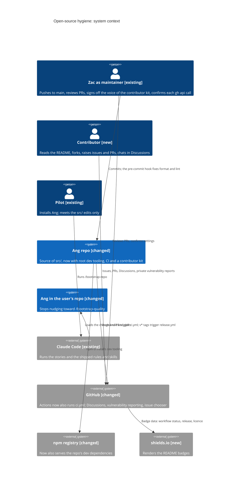

# C4 level 1: context for open-source hygiene

## Summary
This epic is about the **Ang repo** as a project people read, fork and contribute to, not about Ang as installed in a user's repo. It adds one person, the **contributor**, who reads the README, raises issues and pull requests, and talks in Discussions. **GitHub** gains a CI workflow, Discussions, private vulnerability reporting and an issue chooser. The **npm registry** now also serves the repo's dev-only tooling. **shields.io** draws the README badges. The installed Ang changes in only three prose files (story 6). Orca, Git's stream branch and the fixture repo are unaffected and left out.

Status labels: **[new]** is built by this epic, **[changed]** exists and changes here, and **[existing]** is drawn only for context.

## Diagram

## Elements
| Element | Status | Role in this epic |
|---|---|---|
| Zac as maintainer | existing | Pushes to `main` directly; CI is advisory, so nothing blocks him (d18). Signs off the kit's voice and confirms each settings call (k14) |
| Contributor | new | Reaches the repo through the README. Issues lead with open conversation; the PR template asks how the change serves every Ang user (d12) |
| Pilot | existing | Sees only story 6: no nudge in the rule, and a `/trigger` offer in `/bootstrap-repo` (d10, d15) |
| Ang repo | changed | Root tooling, `ci.yml`, community files, README sections and badges. None of it is under `src/`, so `install.sh` never copies it |
| Ang in the user's repo | changed | Three prose edits; no new files, no tooling |
| GitHub | changed | Already hosts releases and `release.yml`. Gains `ci.yml`, Discussions, private vulnerability reporting, the issue chooser; wiki and projects go off (d19) |
| npm registry | changed | Already serves giget through `npx` for installs. Now serves the root dev dependencies for this repo only; the shipped script stays zero-dependency ([ADR 0002](/project-context/10k/technical/adrs/0002-zero-dependency-library-script.md)) |
| shields.io | new | Four badges: CI status, licence, Node `>=26` from `engines`, latest release (k14) |

## Related
- [Containers](2-containers.md)
- [Plan](../plan.md)
- [10k context](/project-context/10k/technical/architecture/1-context.md)
