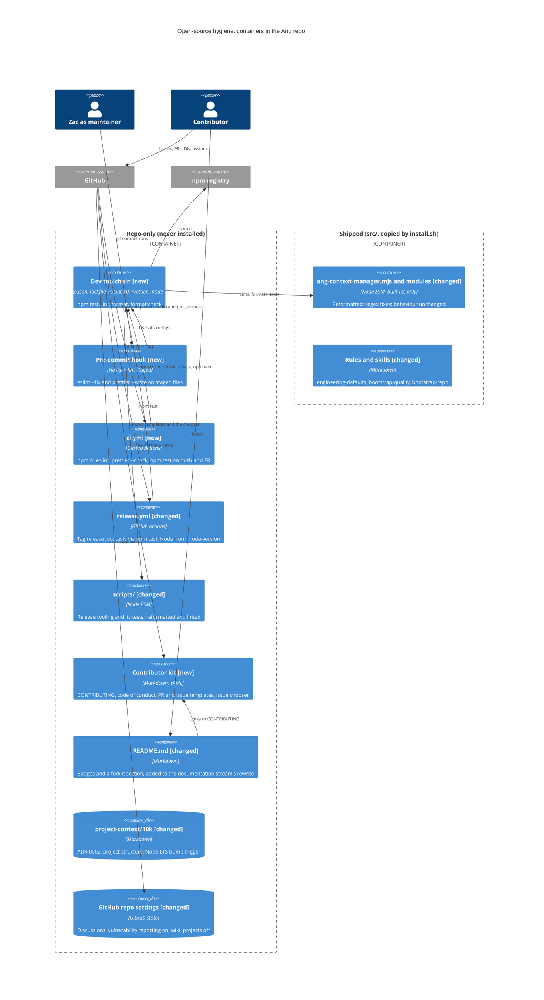

# C4 level 2: containers for open-source hygiene

## Summary
The Ang repo splits into **repo-only** containers, which never leave the repo, and the **shipped** `src/` tree, which `install.sh` copies. Everything this epic builds is repo-only except three prose edits in `src/.claude/`. The new **dev toolchain** at the root lints, formats and tests `src/` and `scripts/`. The **pre-commit hook** runs it on staged files, and **`ci.yml`** runs it on every push and PR. `release.yml` keeps its job and calls the same `npm test`. The **contributor kit** and **README** are what a contributor reads; **GitHub repo settings** are state on GitHub, not files. Here a "container" is a separately run or read unit, as in [10k containers](/project-context/10k/technical/architecture/2-containers.md).

Status labels are those in [context](1-context.md).

## Diagram

## Containers
| Container | Status | What changes |
|---|---|---|
| Dev toolchain | new | Private, dev-only root `package.json` with `engines.node >=26`, lockfile, `.node-version`, `eslint.config.mjs`, Prettier config and ignores, `node_modules/` in `.gitignore` (d8, d9, d3, d17, d21) |
| Pre-commit hook | new | `.husky/pre-commit` runs lint-staged. Auto-fix on, so it rarely stops a commit (d1) |
| `ci.yml` | new | One job, advisory, no branch protection (k13, d18). Its status drives the README badge |
| `release.yml` | changed | Test step becomes `npm test` (d16); `setup-node` reads `.node-version` (d20). No `npm ci`, because `npm test` is plain `node --test` and needs no packages |
| `scripts/` | changed | Formatting and lint fixes only |
| Contributor kit | new | All under the repo root and `.github/`, none in `src/` (d4, d6, d12) |
| README | changed | Additive sections on top of the documentation stream's rewrite |
| `project-context/10k` | changed | [ADR 0002](/project-context/10k/technical/adrs/0002-zero-dependency-library-script.md) amended (d14); [project structure](/project-context/10k/technical/project-structure.md) gains the toolchain, hook and `ci.yml`; the [Node LTS bump trigger](/project-context/triggers/node-lts-bump.md) covers `.node-version`, `engines` and both workflows |
| GitHub repo settings | changed | Flipped with `gh api`, each confirmed by Zac and read back (k14, d19) |
| Shipped script | changed | Prettier pass plus hand fixes for the lint findings. Still imports only Node built-ins, so ADR 0002's decision for installs holds |
| Shipped rules and skills | changed | The nudge sentence and "flag that instead" go; `/bootstrap-repo` step 7 offers a `/trigger` (d10, d15) |

## Related
- [Context](1-context.md)
- [Components](3-components.md)
- [Plan](../plan.md)
- [10k containers](/project-context/10k/technical/architecture/2-containers.md)
