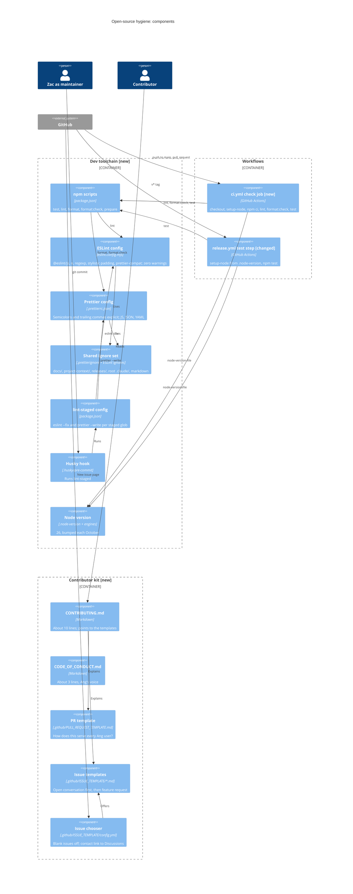

# C4 level 3: components for open-source hygiene

## Summary
Three containers have parts worth drawing: the **dev toolchain**, the **workflows** and the **contributor kit**. In the toolchain, `package.json` scripts are the only entry points. The hook, `ci.yml` and `release.yml` all call them and never call ESLint, Prettier or `node --test` directly, so the test globs and tool flags live in one file. ESLint and Prettier share one **ignore set**, so both tools see the same files. In the kit, the **issue chooser** sends chat to Discussions, so Discussions must be on before it lands (story 4 before story 5). The shipped containers change in content only, so they are not broken down here.

Status labels are those in [context](1-context.md).

## Diagram

## Components
| Component | Status | Responsibility | Decisions |
|---|---|---|---|
| npm scripts | new | The single home for every check command and the test globs | d8, k3, k13 |
| ESLint config | new | d9's set, `globals.node`, `reportUnusedDisableDirectives: "error"`, `n/no-process-exit` off, `n/prefer-node-protocol` on, d9's readability rules | d1, d9 |
| Prettier config | new | Defaults plus `semi: true` and `trailingComma: "all"` written out | d3, d17 |
| Shared ignore set | new | One list, applied to both tools. Root `.claude/` is ignored because it symlinks into `src/.claude` and would be linted twice | d1, k13 |
| lint-staged and Husky | new | Auto-fix on commit; `prepare` installs the hook on `npm ci` or `npm install` | d1 |
| Node version | new | `.node-version` and `engines` move together; both workflows read the file | d11, d20 |
| `ci.yml` check job | new | Advisory. No required checks, no branch protection | k13, d18 |
| `release.yml` test step | changed | Two one-line swaps; every other step unchanged | d13, d16, d20 |
| CONTRIBUTING, code of conduct | new | Short and in Ang's voice; Zac signs off the wording | d4, d6 |
| PR and issue templates | new | Rubber-ducking nudges toward [first principles](/project-context/10k/product/first-principles.md), not gates | d12 |
| Issue chooser | new | Needs Discussions on (story 4) for its contact link | k14 |

## Related
- [Containers](2-containers.md)
- [Code](4-code.md)
- [What the templates are for](../origins/open-source-hygiene/shaping-content/pr-template-purpose.md)
- [ESLint plugins](../origins/open-source-hygiene/shaping-content/eslint-plugins.md)
